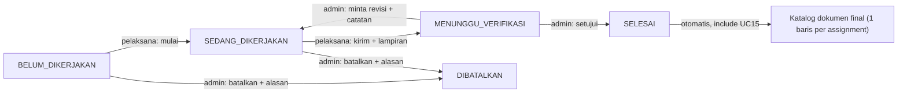
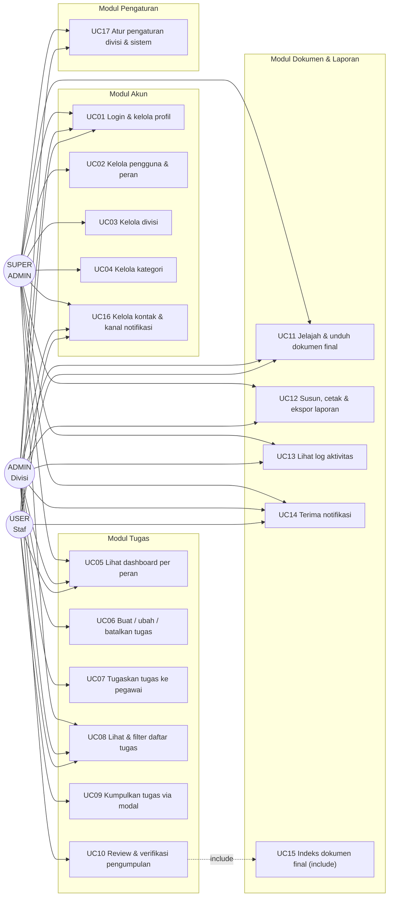
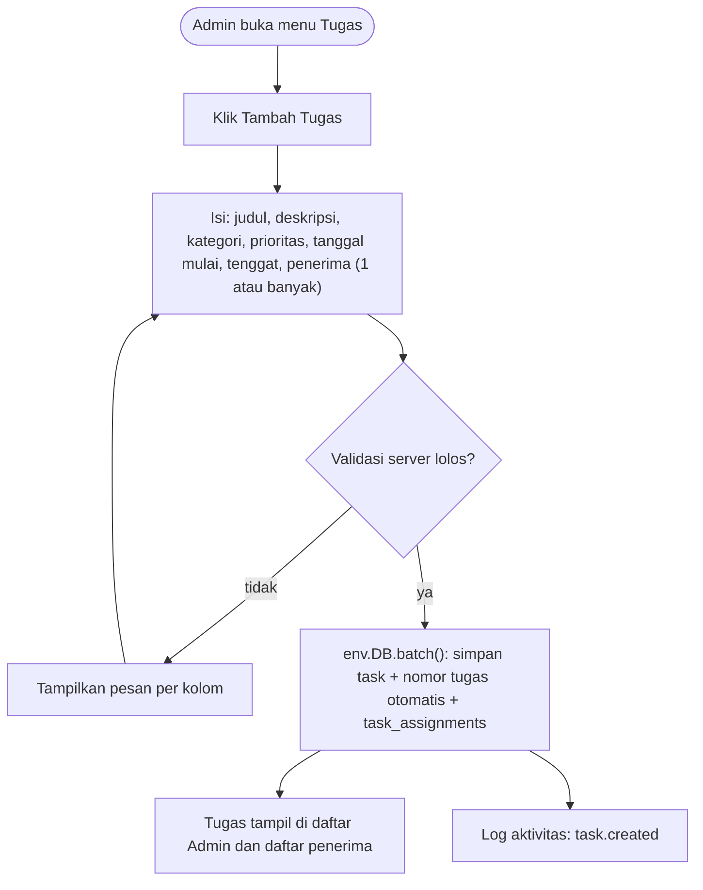
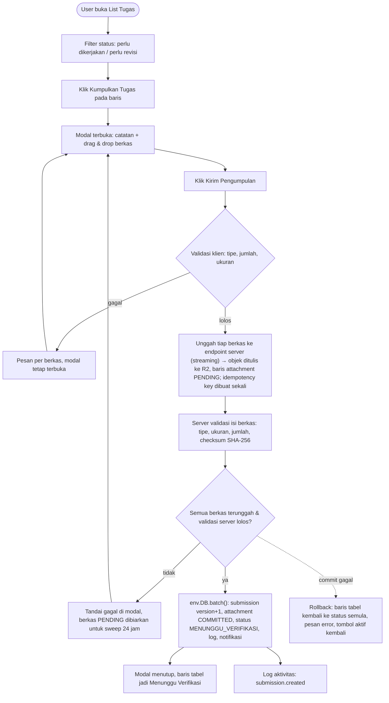
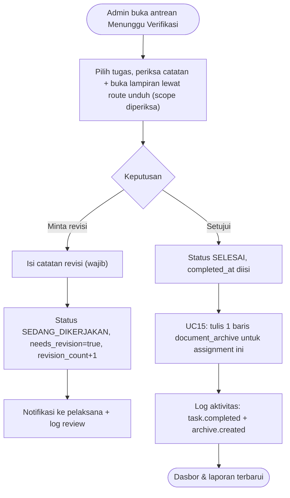
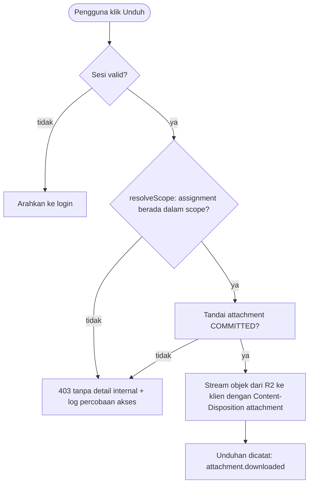
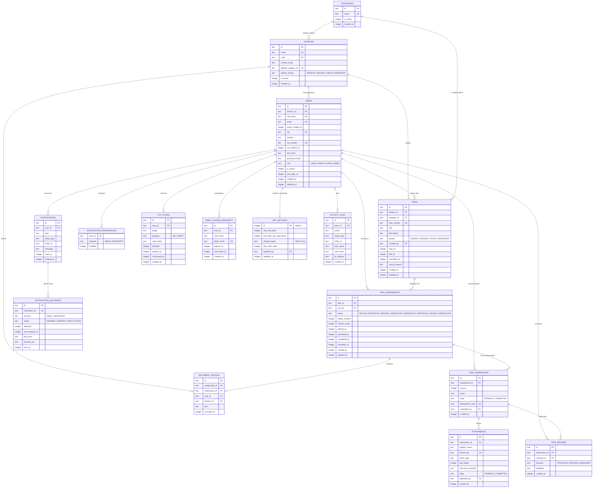
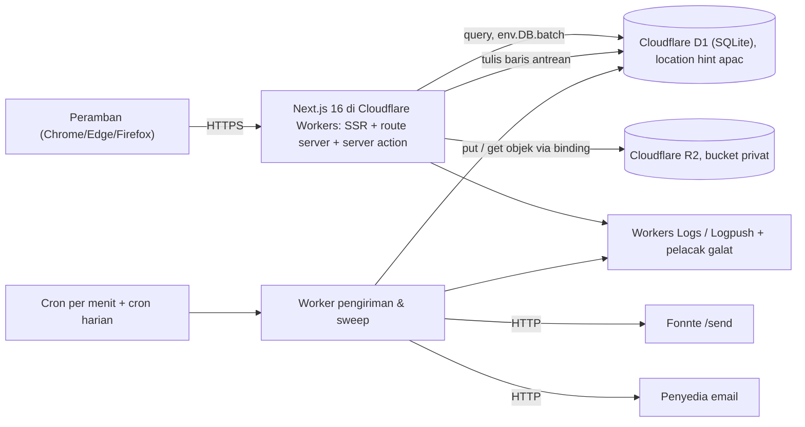
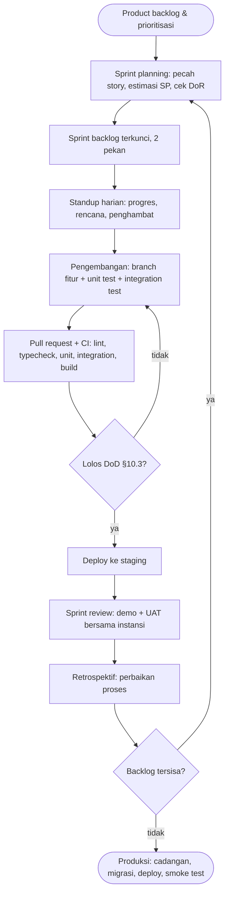

# Portal Manajemen Penugasan & Dokumen Divisi: Rancangan Sistem

| Informasi | Keterangan |
|---|---|
| Versi | 2.2 |
| Tanggal | 19 Oktober 2026 |
| Status | Acuan implementasi (menggantikan v1) |
| Menggantikan | "Portal Pengarsipan & Manajemen Penugasan Divisi" (v1) |
| Cakupan | RBAC, status & transisi, use case, alur operasional, skema data, metrik dashboard, pola modal, kanal notifikasi, pengaturan operasional, arsitektur & NFR, siklus Agile |
| Stack | Next.js 16 (App Router) + Drizzle ORM + `@opennextjs/cloudflare` di Cloudflare Workers; basis data Cloudflare D1; berkas di Cloudflare R2 |

Dokumen ini menggantikan v1. Setiap perubahan dari v1 tercatat di §0 supaya bisa ditelusuri, bukan tersebar sebagai kesepakatan lisan.

---

## 0. Perubahan dari v1

| # | Temuan pada v1 | Perbaikan di v2 | Bagian |
|---|---|---|---|
| 1 | RBAC memberi Super Admin izin membuat & memverifikasi tugas, tetapi diagram use case tidak menghubungkan SA ke UC tersebut | Izin SA ditetapkan ulang: kelola master + pengawasan baca-saja lintas divisi. Panah use case disinkronkan | §2, §4 |
| 2 | "Pengarsipan Otomatis" digambar sebagai use case milik aktor padahal proses sistem yang ter-trigger | Jadi `include` dari review (UC15), bukan use case berdiri sendiri | §4 |
| 3 | Tiga kosakata status berbeda (`PENDING/SUBMITTED/REVISION/COMPLETED`, `MENUNGGU VERIFIKASI/REVISI/SELESAI`, label chip) tanpa tabel transisi | Satu daftar status kanonik + tabel transisi (aktif, guard, efek) | §3 |
| 4 | Revisi dijadikan status sendiri sehingga tidak ada sinyal "sedang dikerjakan"; metrik progres mustahil dihitung | Revisi = transisi; `needs_revision` dan `revision_count` jadi kolom turunan | §1 D2, §3.3 |
| 5 | Arsip dikunci ke `submission_id`, sedangkan revisi menghasilkan banyak submission → arsip ganda tanpa penanda mana yang sah | Arsip dikunci ke `assignment_id` dengan unique constraint, menunjuk submission final | §1 D1, §6.2 |
| 6 | Unggah dua fase (presigned + commit metadata) tanpa pembersih berkas yatim; optimistic UI tanpa aturan rollback | Status attachment `PENDING/COMMITTED`, idempotency key, sweep >24 jam, rollback eksplisit | §8 |
| 7 | Notifikasi dijanjikan di tiga flowchart tanpa entitas, kanal, atau status baca | Tabel `notifications` + kanal in-app, dipicu setelah commit transaksi | §1 D8, §5A, §5C, §6.1 |
| 8 | "Catat Jejak Audit Trail" dan audit log sprint tanpa tabel | `activity_logs` jadi satu-satunya sumber riwayat status & jejak audit | §6.1 |
| 9 | Tidak ada use case/field untuk ubah, batalkan, alihkan tugas, atau perpanjang tenggat | Ditambahkan di UC06, §3.2, dan kolom `cancelled_at`, `cancel_reason` | §3, §4 |
| 10 | Satuan metrik campur: "Total Tugas" bisa berarti task atau assignment | Satuan ditetapkan per metrik (assignment untuk progres, task untuk jumlah judul) | §7.1 |
| 11 | Distribusi status berpotensi tumpang tindih (tugas pernah `REVISION` lalu `SELESAI` masuk dua kategori) | Status tunggal per assignment → kategori saling eksklusif, jumlah selalu 100% | §7.1 |
| 12 | Tidak ada metrik keterlambatan; ambang "mendekati tenggat" tidak didefinisikan | Kartu Terlambat + ambang eksplisit (3 hari) | §7.1, §7.2 |
| 13 | Tipe waktu campur (`integer` epoch vs `text` deadline), timezone tidak ditetapkan padahal UI menampilkan WIB | Satu konvensi waktu: epoch detik UTC di DB, render `Asia/Jakarta` | §1 D3, §6.3 |
| 14 | Metadata arsip lebih miskin dari sumbernya (tanpa nama berkas, ukuran, mime, pengunggah) | Arsip merujuk submission, sehingga seluruh metadata berkas melekat pada satu sumber | §6.1 |
| 15 | Tidak ada unique `(task_id, user_id)`; tidak ada indeks untuk agregasi dashboard | Constraint + daftar indeks wajib | §6.2 |
| 16 | Gate "Lolos Kriteria DoD?" tanpa DoD; CI hanya lint/build/typecheck walau siklus menyebut unit test | DoR, DoD, dan cakupan tes eksplisit; CI menjalankan unit + integration test | §10 |
| 17 | Klaim "spesifikasi arsitektur" tanpa topologi, auth, storage, backup, atau NFR | §9 ditambahkan lengkap dengan asumsi hosting | §9 |
| 18 | Tidak ada glosarium, daftar nilai enum, atau definisi istilah | Kamus enum + konvensi di §6.3, definisi metrik di §7.1 | §6.3, §7.1 |
| 19 | Judul "Portal Pengarsipan" menyiratkan aplikasi ini arsip resmi instansi | Judul diubah; modul dokumen diposisikan sebagai katalog dokumen pendukung | §1.1 |

### 0.1 Perubahan pada v2.1: penyelarasan platform Cloudflare

Stack ditetapkan: Next.js 16 + Drizzle ORM + Cloudflare Workers (`@opennextjs/cloudflare`), D1, R2. Kendala platform yang diverifikasi dari dokumentasi resmi (§9.10 memuat sumbernya) mengubah empat hal:

| Aspek | v2.0 | v2.1 | Alasan |
|---|---|---|---|
| Transaksi | "dibungkus transaksi" (transaksi interaktif) | Semua tulis majemuk lewat `env.DB.batch([...])` (atomik: satu statement gagal, seluruh rangkaian dibatalkan) | D1 tidak menerima `BEGIN`/`COMMIT` dari pengguna; setiap query sudah dijalankan di dalam transaksi implisit |
| Unggah berkas | presign langsung dari peramban ke object storage | unggah lewat endpoint server ke binding R2 (streaming), tetap dua fase `PENDING → COMMITTED` | Presign R2 memerlukan kredensial S3 terpisah dan implementasi SigV4; berkas kita maksimal 10 MB, jauh di bawah batas body 100 MB |
| Unduh berkas | signed GET berumur 5 menit | route server memeriksa scope tiap permintaan lalu streaming objek dari R2 | Menghapus kelas risiko "URL tersebar dan tidak bisa dicabut" |
| Kredensial sandi | Argon2id (atau bcrypt cost ≥ 12) | PBKDF2-SHA256 via WebCrypto dengan iterasi sesuai anjuran OWASP | WebCrypto di Workers menyediakan PBKDF2/HKDF, tidak menyediakan Argon2; Argon2 lewat WASM membebani CPU per permintaan |

Tiga prasyarat yang mengikat sebelum go-live: paket **Workers Paid** (limit CPU Free 10 ms per permintaan tidak cukup untuk hashing + SSR), build/deploy **dijalankan di CI Linux** (dukungan OpenNext di Windows tidak dijamin), dan **persetujuan instansi atas residensi data** (tidak ada yurisdiksi Indonesia, §12 #8).

### 0.2 Perubahan pada v2.2: kanal notifikasi eksternal

Keputusan produk 19 Oktober 2026: notifikasi tidak lagi in-app saja. Email dan WhatsApp ditambahkan sebagai kanal opsional, **mati secara default**, dan hanya menyala setelah alamatnya diverifikasi pemilik akun.

| Aspek | v2.1 | v2.2 | Alasan |
|---|---|---|---|
| Kanal | in-app saja | in-app wajib, email dan WhatsApp opsional per akun | Notifikasi revisi dan tenggat dianggap penting oleh pemilik produk, tetapi kanal luar tidak boleh menghilangkan sumber kebenaran in-app |
| Identitas vs kontak | semua data pengguna diubah Super Admin | identitas (nama, NIP, jabatan, divisi, peran, username) tetap Super Admin; email dan nomor WhatsApp diubah pemilik akun setelah verifikasi | Hanya pemilik yang tahu alamat dan nomornya; memaksa Super Admin memasukkan nomor orang lain menghasilkan salah ketik yang tidak terdeteksi |
| NIP | kolom ada, tanpa jalur tulis | input wajib tersedia di Kelola Master, **opsional diisi**, 18 digit bila diisi, unik | Pegawai non-PNS tidak punya NIP; kolom tanpa input membuat data tidak pernah lengkap |
| Nomor WhatsApp | tidak ada | disimpan E.164, **unik satu akun**, terverifikasi OTP | Satu nomor yang dipakai dua akun membuat notifikasi penting mendarat di orang yang salah |
| Pengiriman | tidak ada pengiriman | tabel outbox `notification_deliveries` + Worker cron per menit | Workers tidak punya retry setelah respons; tanpa outbox satu gangguan penyedia menghilangkan notifikasi permanen |
| Penyedia | tidak ada | email lewat penyedia HTTP, WhatsApp lewat Fonnte | Fonnte tidak menuntut template dan verifikasi bisnis, sesuai kapasitas instansi |

Konsekuensi yang harus diingat: kanal luar bersifat best-effort. Status yang bisa dijamin hanya "diterima penyedia". Fonnte mengembalikan `process: pending`, dan pengiriman akhir bergantung pada perangkat WhatsApp yang tersambung.

### 0.3 Perubahan pada v2.2: layar Pengaturan

Layar Pengaturan (L18) dijadikan layar resmi dengan dua tab. Tab Divisi untuk Admin Divisi dan Super Admin, tab Sistem hanya untuk Super Admin. Ini memindahkan empat nilai yang sebelumnya tertulis sebagai konstanta di kode dan dokumen.

| Nilai | Sebelumnya | v2.2 | Batas |
|---|---|---|---|
| Ukuran maksimum per berkas | 10 MB, konstanta di D4 dan `attachments` CHECK | Setelan, default 10 MB | Hanya boleh menurunkan, 1 sampai 10 MB; CHECK basis data tetap 10 MB |
| Jumlah berkas per pengumpulan | 5, konstanta | Setelan, default 5 | Hanya boleh menurunkan, 1 sampai 5 |
| Tipe berkas diterima | 8 tipe tetap | Setelan, default 8 tipe | Hanya boleh memilih subset dari 8 tipe kanonik, minimal satu |
| Ambang tenggat dekat | 3 hari, konstanta `DUE_SOON_WINDOW_SECONDS` | Setelan, default 3 | 1 sampai 30 hari |

`divisions.contact_email` bukan sekadar data kontak: alamat itu dipakai sebagai `Reply-To` email notifikasi yang dikirim ke anggota divisi, sehingga balasan mendarat di petugas divisi, bukan alamat pengirim otomatis. Bila kosong, email dikirim tanpa `Reply-To`.

Nilai awal form tugas per divisi (kategori dan prioritas) juga dipindahkan dari kebiasaan admin ke data divisi. Identitas divisi (nama, kode, kepala) tetap di Kelola Master dan ditampilkan baca-saja di L18, supaya satu kolom tidak punya dua layar penulis.

Setiap simpan menulis `activity_logs` dengan nilai lama dan baru. Setelan dibaca per permintaan, tanpa cache, karena satu baris primary key lebih murah daripada risiko nilai basi yang mengubah validasi unggah.

---

## 1. Batas sistem & keputusan desain

### 1.1 Termasuk dan tidak termasuk

**Termasuk:** autentikasi & peran; kelola divisi, pengguna, kategori; pembuatan dan pendistribusian tugas; pengumpulan hasil kerja beserta dokumen; review, revisi, penyelesaian; katalog dokumen final (read-only); dashboard per peran; laporan & ekspor; notifikasi in-app; notifikasi email dan WhatsApp yang **opsional per akun dan mati secara default**; log aktivitas.

**Tidak termasuk:** arsip resmi instansi dan jadwal retensi kearsipan (tetap di sistem kearsipan instansi); tanda tangan elektronik tersertifikasi; integrasi langsung ke aplikasi eksternal selain penyedia pengiriman pesan; chat internal; notifikasi SMS; aplikasi seluler; persetujuan bertingkat berjenjang; penggajian.

### 1.2 Keputusan desain

| Kode | Keputusan | Alasan |
|---|---|---|
| **D1** | Katalog dokumen final (arsip) = **satu baris per assignment**, menunjuk submission terakhir yang disetujui. Berkas tidak disalin ulang | Revisi menghasilkan banyak submission; tanpa kunci per assignment, satu tugas bisa punya beberapa baris arsip dan tidak ada yang tahu mana yang sah |
| **D2** | Revisi adalah **transisi** `MENUNGGU_VERIFIKASI → SEDANG_DIKERJAKAN`, bukan status | Status `SEDANG_DIKERJAKAN` dibutuhkan untuk memantau progres dan peringatan tenggat; kalau revisi jadi status, sinyal itu hilang |
| **D3** | Waktu disimpan sebagai **epoch detik UTC** (`integer`), dirender `Asia/Jakarta`. Tenggat diisi pengguna sebagai tanggal → disimpan sebagai akhir hari **23:59:59 WIB** | Satu konvensi menghilangkan kelas bug perbandingan terlambat; "Sisa 4 jam" di dashboard menjadi deterministik |
| **D4** | Satu pengumpulan membawa **banyak lampiran**: 10 MB/berkas dan 5 berkas/pengumpulan adalah **batas atas**, tipe di-allowlist. Nilai aktif dibaca dari `app_settings` dan hanya dapat diturunkan (default 10 MB dan 5) | Batas per-berkas dan per-pengumpulan berbeda; tanpa pemisahan ini validasi tidak bisa ditegakkan. Batas atas tetap di kode dan CHECK basis data supaya setelan yang salah tidak membuka keran |
| **D5** | Bucket R2 **privat**; unduhan hanya lewat route server yang memeriksa scope tiap permintaan, lalu streaming objek dengan `Content-Disposition: attachment`; nama simpan internal acak | URL statis maupun *signed* yang tersebar tidak bisa dicabut; pemeriksaan scope per permintaan menutup celah itu tanpa perlu kredensial S3 terpisah |
| **D6** | Unggah berkas lewat endpoint server ke binding R2 (streaming, bukan presign), status attachment `PENDING → COMMITTED`, `idempotency_key` unik, dan sweep berkas `PENDING` lebih tua dari 24 jam | Unggahan berkas dan penulisan metadata tidak berada dalam satu transaksi; tanpa penanda status, kegagalan commit meninggalkan berkas yatim yang tidak terlihat |
| **D7** | Satu tugas boleh punya **banyak penerima**; `UNIQUE(task_id, user_id)` | Flowchart v1 sudah menjanjikan "1 atau banyak pegawai", tetapi tanpa constraint satu staf bisa ditugaskan dua kali di tugas yang sama |
| **D8** | Notifikasi **in-app wajib**, email dan WhatsApp **opsional per akun** dan mati secara default. Setiap notifikasi menulis satu baris `notifications` dan nol atau lebih baris `notification_deliveries` dalam `batch()` yang sama; pengiriman luar dilakukan Worker terpisah | In-app adalah sumber kebenaran yang tidak boleh bergantung pada penyedia luar. Memisahkan baris pengiriman membuat retry, kegagalan per kanal, dan audit bisa dibaca tanpa mencampur status baca notifikasi |
| **D9** | Tidak ada penghapusan permanen untuk entitas beriwayat: gunakan nonaktif / pembatalan / soft delete | Riwayat yang hilang membuat laporan dan audit tidak dapat dipercaya |
| **D10** | Penempatan: Cloudflare Workers + D1 + R2 (pilihan pemilik produk). Basis data dibuat dengan location hint `apac`; yurisdiksi Indonesia tidak tersedia (D1/R2 hanya menyediakan yurisdiksi `eu`), sehingga persetujuan tertulis instansi menjadi prasyarat go-live | Data kepegawaian dan dokumen internal memerlukan dasar persetujuan eksplisit; rincian kendala di §9.10 dan keputusan di §12 #8 |
| **D11** | **Pemisahan identitas dan kontak.** Nama, NIP, jabatan, divisi, peran, dan username diubah Super Admin. Email dan nomor WhatsApp diubah pemilik akun, dan hanya berlaku sebagai target notifikasi setelah diverifikasi | Salah ketik pada alamat atau nomor hanya bisa dicegah oleh pemiliknya; Super Admin yang mengetikkan nomor orang lain tidak punya cara memverifikasinya |
| **D12** | Nomor WhatsApp **unik lintas akun** dan disimpan dalam bentuk E.164. Klaim nomor yang sudah terverifikasi di akun lain ditolak dengan pesan umum | Dua akun dengan nomor sama membuat notifikasi tugas mendarat di orang yang salah, dan pemilik nomor tidak bisa mengetahui akun mana yang mengklaimnya |
| **D13** | NIP **opsional** diisi, 18 digit bila diisi, unik. Kosong disimpan `NULL`, bukan string kosong | Pegawai non-PNS tidak memiliki NIP; unique index tetap berlaku untuk nilai yang terisi |
| **D14** | Setelan operasional disimpan sebagai **satu baris `app_settings`** (kebijakan berkas, ambang tenggat) dan **kolom pada `divisions`** (kontak, kategori default, prioritas default). Tidak ada tabel key-value umum | Satu baris bertipe jelas lebih mudah divalidasi dan dibaca daripada tabel key-value yang menampung semua bentuk. Nilai per divisi memang melekat pada divisi, bukan pada kunci global |

---

## 2. Peran & hak akses

Tiga peran: `USER` (staf pelaksana), `ADMIN` (admin divisi), `SUPER_ADMIN`.

Cakupan data (**scope**) membatasi setiap query, bukan hanya tampilan:

- `USER` → assignment yang `user_id` = dirinya.
- `ADMIN` → seluruh data di divisinya (`division_id` = divisinya).
- `SUPER_ADMIN` → seluruh divisi, **baca-saja** untuk data tugas.

| Modul / Fitur | USER | ADMIN (Divisi) | SUPER_ADMIN |
|---|:---:|:---:|:---:|
| Login, profil, ganti kata sandi sendiri | ✅ | ✅ | ✅ |
| Ubah surel sendiri (tautan verifikasi ke alamat baru) | ✅ | ✅ | ✅ |
| Ubah nomor WhatsApp sendiri (kode OTP) | ✅ | ✅ | ✅ |
| Nyalakan atau matikan kanal email dan WhatsApp | ✅ | ✅ | ✅ |
| Ubah NIP (identitas kepegawaian) | ❌ | ❌ | ✅ |
| Atur kontak divisi dan nilai awal form tugas | ❌ | ✅ (divisinya) | ✅ (semua divisi, lewat pemilih divisi) |
| Atur kebijakan berkas dan ambang tenggat | ❌ | ❌ | ✅ |
| Dashboard statistik | Personal | Divisi | Global |
| Kelola divisi (CRUD) | ❌ | ❌ | ✅ |
| Kelola pengguna (CRUD, assign divisi & peran, NIP, jabatan, reset sandi, aktif/nonaktif) | ❌ | ❌ | ✅ |
| Kelola kategori (CRUD master) | ❌ | Lihat | ✅ |
| Buat / ubah tugas | ❌ | ✅ (divisinya) | ❌ (baca-saja) |
| Tugaskan tugas ke pegawai (1 atau banyak) | ❌ | ✅ (anggota divisinya) | ❌ |
| Batalkan tugas (wajib alasan) | ❌ | ✅ (divisinya) | ❌ |
| Perpanjang tenggat (wajib alasan) | ❌ | ✅ (divisinya) | ❌ |
| Lihat daftar & detail tugas | Milik sendiri | Seluruh divisinya | Seluruh divisi, dengan filter |
| Kumpulkan tugas via modal (unggah berkas) | ✅ (assignment miliknya) | ❌ | ❌ |
| Ajukan ulang setelah revisi | ✅ | ❌ | ❌ |
| Review / verifikasi / minta revisi | ❌ | ✅ (divisinya) | ❌ |
| Katalog dokumen final: jelajah & unduh | ✅ (divisinya) | ✅ (divisinya) | ✅ (semua) |
| Laporan & ekspor (XLSX/PDF) | ❌ | ✅ (divisinya) | ✅ (semua) |
| Lihat log aktivitas | ❌ | ✅ (divisinya) | ✅ (semua) |
| Notifikasi in-app (selalu aktif) | ✅ (miliknya) | ✅ (miliknya) | ✅ (miliknya) |
| Notifikasi email dan WhatsApp (opsional, default mati) | ✅ (miliknya, setelah verifikasi) | ✅ (miliknya, setelah verifikasi) | ✅ (miliknya, setelah verifikasi) |

**Aturan penegakan:**

1. Otorisasi diperiksa **di server** untuk setiap operasi (baca, tulis, unduh), bukan di komponen tabel.
2. Satu fungsi `resolveScope(actor)` mengembalikan `{ role, divisionId | allDivisions }`; semua query wajib melewatinya.
3. Super Admin tidak memverifikasi dan tidak membuat tugas. Kalau instansi tetap menuntut SA bisa memverifikasi, itu keputusan §12 #3 dan wajib dicatat pada `activity_logs` sebagai aktor review.
4. Unduhan berkas memeriksa scope pada setiap permintaan unduh; tidak ada URL yang bisa dipakai ulang tanpa pemeriksaan.
5. Perubahan email dan nomor WhatsApp hanya boleh menyentuh baris `users` milik aktor. Server tidak menerima `user_id` dari klien pada operasi ini. Setiap perubahan menulis `activity_logs` berisi nilai lama dan baru, dengan nomor ditampilkan penuh hanya di log.
6. Nomor WhatsApp yang sudah `wa_verified_at` terisi di akun lain tidak dapat diklaim. Pemeriksaan dilakukan di server sebelum OTP dikirim, dan pesan penolakan tidak menyebut pemilik nomor.

---

## 3. Status kanonik & transisi

### 3.1 Daftar status

| Kode | Label UI | Arti | Yang boleh mengubah |
|---|---|---|---|
| `BELUM_DIKERJAKAN` | Belum Dikerjakan | Tugas terdistribusi, belum dimulai pelaksana | Pelaksana (`mulai`), Admin (`batalkan`) |
| `SEDANG_DIKERJAKAN` | Sedang Dikerjakan | Sedang berjalan, juga kondisi setelah revisi | Pelaksana (`kirim`), Admin (`batalkan`) |
| `MENUNGGU_VERIFIKASI` | Menunggu Verifikasi | Pengumpulan masuk, menunggu keputusan Admin | Admin (`setujui` / `minta revisi`) |
| `SELESAI` | Selesai | Disetujui Admin; dokumen final masuk katalog | - (final) |
| `DIBATALKAN` | Dibatalkan | Dihentikan Admin dengan alasan | - (final) |

### 3.2 Tabel transisi

| Dari | Ke | Aktor | Guard | Efek |
|---|---|---|---|---|
| `BELUM_DIKERJAKAN` | `SEDANG_DIKERJAKAN` | Pelaksana | assignment miliknya, task belum dibatalkan | `started_at`, log |
| `SEDANG_DIKERJAKAN` | `MENUNGGU_VERIFIKASI` | Pelaksana | ada ≥1 lampiran `COMMITTED` pada submission terbaru | submission `version+1`, notifikasi ke Admin divisi, log |
| `MENUNGGU_VERIFIKASI` | `SELESAI` | Admin divisi | submission berstatus `COMMITTED` | `completed_at`, review `APPROVED`, katalog dokumen final bertambah 1, log |
| `MENUNGGU_VERIFIKASI` | `SEDANG_DIKERJAKAN` | Admin divisi | **catatan wajib**, tidak kosong | review `REVISION_REQUIRED`, `needs_revision=true`, `revision_count+1`, notifikasi ke pelaksana, log |
| `BELUM_DIKERJAKAN` / `SEDANG_DIKERJAKAN` | `DIBATALKAN` | Admin divisi | **alasan wajib** | `cancelled_at`, `cancel_reason`, notifikasi ke pelaksana, log |
| `SELESAI` / `DIBATALKAN` | apa pun | - | ditolak server | - |

Transisi yang tidak ada di tabel = ditolak server (bukan disembunyikan di UI). Perpanjangan tenggat **bukan** perubahan status; ia mengubah `due_at` dan menulis log berisi nilai lama dan baru.

**Fan-out notifikasi.** Setiap transisi yang menyebut "notifikasi" pada kolom Efek menulis satu baris `notifications` untuk penerima. Pada `batch()` yang sama, server menambahkan satu baris `notification_deliveries` untuk setiap kanal luar yang menyala dan alamatnya terverifikasi. Kanal yang mati tidak menulis baris pengiriman, bukan menulis baris `SKIPPED`, supaya preferensi yang berubah di masa depan tidak mengubah riwayat. `DUE_SOON` ditulis oleh job terjadwal, bukan oleh aksi pengguna, dan hanya sekali per penugasan per ambang.

### 3.3 Nilai turunan (tidak disimpan sebagai status)

| Nilai | Rumus | Dipakai di |
|---|---|---|
| `needs_revision` | review terakhir = `REVISION_REQUIRED` dan status ≠ `SELESAI` | Chip "Perlu Revisi", kartu action required |
| `revision_count` | jumlah review `REVISION_REQUIRED` untuk assignment | Statistik kualitas, dashboard divisi |
| `is_overdue` | `now > due_at` dan status ∉ {`SELESAI`, `DIBATALKAN`} | Kartu Terlambat, filter, laporan |
| `is_due_soon` | `due_at - now ≤ due_soon_days` (default 3 hari) dan status ∈ {`BELUM_DIKERJAKAN`, `SEDANG_DIKERJAKAN`} | Kartu Tenggat Dekat |
| `is_archived` | ada baris di `document_archive` untuk assignment | Chip "Terarsip", tombol unduh bukti |

### 3.4 Diagram state



---

## 4. Use case



| Kode | Use case | Aktor |
|---|---|---|
| UC01 | Login, kelola profil, ganti kata sandi | Semua |
| UC02 | Kelola pengguna & peran (CRUD, assign divisi, NIP, jabatan, reset sandi, aktif/nonaktif) | Super Admin |
| UC03 | Kelola divisi (CRUD, nonaktifkan) | Super Admin |
| UC04 | Kelola kategori (CRUD master) | Super Admin |
| UC05 | Lihat dashboard sesuai peran & scope | Semua |
| UC06 | Buat, ubah, batalkan tugas; perpanjang tenggat | Admin |
| UC07 | Tugaskan tugas ke satu atau banyak pegawai divisinya | Admin |
| UC08 | Lihat & filter daftar tugas sesuai scope | Semua |
| UC09 | Kumpulkan tugas via modal (unggah lampiran, ajukan ulang setelah revisi) | User |
| UC10 | Review pengumpulan: setujui atau minta revisi dengan catatan | Admin |
| UC11 | Jelajah & unduh dokumen final sesuai scope | Semua |
| UC12 | Susun laporan, cetak, ekspor XLSX/PDF sesuai filter | Admin, Super Admin |
| UC13 | Lihat log aktivitas | Admin, Super Admin |
| UC14 | Terima & tandai baca notifikasi (in-app wajib, email/WhatsApp opsional) | Semua |
| UC16 | Ubah email & nomor WhatsApp sendiri, verifikasi, nyalakan atau matikan kanal | Semua |
| UC17 | Atur kontak dan nilai awal divisi, kebijakan berkas, dan ambang tenggat | Admin (divisinya), Super Admin (semua) |
| UC15 | Indeks dokumen final setelah pengesahan (proses sistem) | Termasuk dari UC10 |

---

## 5. Alur operasional

### A. Pembuatan & distribusi tugas (Admin)



Invariant: nomor tugas dan baris `tasks`/`task_assignments`/`activity_logs` ditulis dalam satu panggilan `env.DB.batch()` (D1 menolak `BEGIN`/`COMMIT` dari pengguna; satu statement gagal membatalkan seluruh rangkaian). Notifikasi in-app dan baris `notification_deliveries` untuk kanal luar yang menyala ditulis pada rangkaian `batch()` yang sama. Pengiriman luar dilakukan Worker terpisah setelah commit, sehingga tugas tidak pernah gagal tersimpan hanya karena penyedia pesan bermasalah.

### B. Pengumpulan tugas via modal (User)



Invariant: tombol terkunci setelah ditekan pertama (idempotency key) sehingga klik ganda tidak membuat dua submission. Berkas yatim dibersihkan job sweep, bukan dibiarkan permanen. Commit memakai `env.DB.batch()`: D1 tidak menerima `BEGIN`/`COMMIT` buatan aplikasi.

### C. Review, revisi & indeks dokumen final (Admin)



Invariant: `document_archive` unik per assignment; menyetujui ulang assignment yang sama memperbarui baris yang ada, tidak menambah baris baru.

### D. Akses dokumen (semua peran)



---

## 6. Skema data

### 6.1 ERD



### 6.2 Constraint & indeks wajib

| Objek | Constraint | Alasan |
|---|---|---|
| `task_assignments` | `UNIQUE(task_id, user_id)` | Satu staf tidak ditugaskan dua kali di tugas yang sama |
| `task_assignments` | `CHECK(status IN (...))` | Mencegah nilai status di luar daftar kanonik §3.1 |
| `tasks` | `UNIQUE(task_number)` | Nomor tugas tidak boleh bentrok (dibuat dalam transaksi bersamaan) |
| `users` | `UNIQUE(username)`, `UNIQUE(email)`, `UNIQUE(nip)`, `UNIQUE(wa_number)`, simpan email lowercase dan nomor E.164 | Username/email tidak boleh mengandung dua baris berbeda karena kapitalisasi; satu nomor WhatsApp hanya boleh menunjuk satu akun. Nilai kosong disimpan `NULL`, karena unique index SQLite mengizinkan banyak `NULL` tetapi tidak banyak string kosong |
| `app_settings` | `CHECK(id = 1)`, `CHECK(max_file_bytes BETWEEN 1048576 AND 10485760)`, `CHECK(max_files_per_submission BETWEEN 1 AND 5)`, `CHECK(due_soon_days BETWEEN 1 AND 30)` | Satu baris setelan; batas hanya boleh menurunkan nilai default, tidak pernah melewati batas aplikasi |
| `divisions` | `default_priority` `NOT NULL DEFAULT 'SEDANG'` CHECK terhadap 4 nilai; `default_category_id` FK `ON DELETE RESTRICT` | Nilai awal form harus nilai yang sah; kategori beriwayat tidak boleh terhapus |
| `notification_preferences` | `PRIMARY KEY(user_id, channel)` | Satu baris per kanal per akun; tidak ada preferensi ganda |
| `notification_deliveries` | `UNIQUE(notification_id, channel)` | Satu notifikasi hanya boleh dikirim sekali per kanal; retry memperbarui baris yang sama |
| `otp_codes` | indeks `(user_id, purpose, created_at)` dan `(target, created_at)` | Pemeriksaan batas kirim per akun dan per nomor |
| `email_change_requests` | `UNIQUE(token_hash)` | Token tidak boleh dipakai dua permintaan |
| `categories` | `UNIQUE(name)` | Master kategori tidak ganda |
| `task_submissions` | `UNIQUE(assignment_id, version)`, `UNIQUE(idempotency_key)` | Versi pengumpulan tidak bisa sama, klik ganda tidak membuat submission duplikat |
| `document_archive` | `UNIQUE(assignment_id)` | Satu tugas = satu dokumen final sah |
| `attachments` | `UNIQUE(stored_key)` | Satu objek storage hanya dirujuk satu baris |
| `tasks.due_at` | `CHECK(due_at >= start_at)` | Tenggat tidak mendahului tanggal mulai |
| FK | `ON DELETE RESTRICT` untuk entitas beriwayat | Riwayat tidak boleh terhapus lewat penghapusan induk |

| Indeks | Alasan |
|---|---|
| `task_assignments(user_id, status)` | Dashboard pribadi |
| `task_assignments(status, updated_at)` | Antrean review per divisi |
| `tasks(division_id, status, due_at)` | Metrik dashboard divisi & kartu tenggat |
| `tasks(division_id, created_at)` | Laporan periode |
| `notifications(user_id, read_at)` | Lencana notifikasi belum dibaca |
| `notification_deliveries(status, next_attempt_at)` | Worker pengiriman mengambil baris yang jatuh tempo |
| `otp_codes(target, created_at)` | Batas kirim OTP per nomor |
| `otp_codes(user_id, purpose, created_at)` | Batas kirim OTP per akun |
| `activity_logs(entity_type, entity_id, created_at)` | Riwayat satu tugas, halaman audit |
| `attachments(submission_id, state)` | Sweep berkas `PENDING` |
| `document_archive(division_id, archived_at)` | Katalog & ekspor |

### 6.3 Kamus enum & konvensi

| Domain | Nilai |
|---|---|
| `users.role` | `USER`, `ADMIN`, `SUPER_ADMIN` |
| `tasks.priority` | `RENDAH`, `SEDANG`, `TINGGI`, `MENDESAK` (default `SEDANG`) |
| `task_assignments.status` | `BELUM_DIKERJAKAN`, `SEDANG_DIKERJAKAN`, `MENUNGGU_VERIFIKASI`, `SELESAI`, `DIBATALKAN` |
| `task_reviews.decision` | `APPROVED`, `REVISION_REQUIRED` |
| state berkas | `PENDING`, `COMMITTED` |
| notifikasi `type` | `TASK_ASSIGNED`, `REVISION_REQUESTED`, `SUBMISSION_RECEIVED`, `TASK_CANCELLED`, `DUE_SOON` |
| kanal pengiriman | `EMAIL`, `WHATSAPP` |
| status pengiriman | `PENDING`, `SENDING`, `SENT`, `FAILED` |
| `otp_codes.purpose` | `WA_VERIFY` |

**Konvensi waktu.** Semua kolom waktu = epoch detik UTC (`integer`). Render di UI memakai `Asia/Jakarta`. Tenggat dari input tanggal diperlakukan sebagai akhir hari 23:59:59 WIB. Perbandingan `is_overdue` memakai waktu server dalam UTC, tidak pernah memakai waktu klien.

**Konvensi teks.** Email disimpan lowercase dan `NULL` bila kosong. NIP disimpan sebagai digit saja, tanpa spasi atau titik, dan `NULL` bila kosong. Nomor WhatsApp disimpan E.164 dengan awalan `+62`, hanya digit setelah tanda plus; saat dikirim ke Fonnte, tanda plus dilepas dan `countryCode` diisi `62`. `stored_key` = `uploads/<division_id>/<yyyymm>/<uuid>.<ext>`, tanpa nama asli, tanpa path yang bisa ditebak. Nilai lama pada `activity_logs.prev_value`/`new_value` disimpan sebagai JSON string agar audit bisa membedakan sebelum-sesudah tanpa tabel tambahan.

**Konvensi setelan.** `divisions.contact_email` `NULL` bila kosong, divalidasi bentuknya di server (maks 254 karakter). `divisions.default_priority` `NOT NULL DEFAULT 'SEDANG'`; `default_category_id` `NULL` berarti form membuka pilihan kategori kosong. `app_settings.allowed_types` disimpan sebagai JSON array berisi subset dari 8 tipe kanonik (PDF, DOC, DOCX, XLS, XLSX, JPG, JPEG, PNG), minimal satu. Nilai di luar subset ditolak server saat simpan, bukan dibersihkan diam-diam. `divisions.default_category_id` menunjuk kategori aktif; bila kategori itu dinonaktifkan, form kembali ke pilihan kosong dan menampilkan catatan, bukan memakai kategori nonaktif.

### 6.4 Setelan operasional

`app_settings` selalu satu baris (`id = 1`) yang dibuat oleh migrasi, bukan oleh pengguna. Baris ini dibaca setiap permintaan yang memvalidasi unggahan atau menghitung `is_due_soon`; tidak ada cache, karena satu pembacaan primary key lebih murah daripada risiko nilai basi yang mengubah hasil validasi.

Aturan tulis:

1. Hanya Super Admin yang boleh menulis `app_settings`; hanya Admin Divisi dan Super Admin yang boleh menulis kolom setelan pada `divisions`. Admin memakai `division_id` dari sesi, bukan dari klien; Super Admin boleh memilih divisi, dan server tetap memvalidasi bahwa id itu ada.
2. Server memvalidasi ulang setiap nilai: `max_file_bytes` 1 sampai 10 MB, `max_files_per_submission` 1 sampai 5, `due_soon_days` 1 sampai 30, `allowed_types` subset tidak kosong.
3. Setiap simpan menulis satu baris `activity_logs` berisi nilai lama dan baru untuk kolom yang berubah, dengan aksi `settings.updated` untuk `app_settings` dan `division.updated` untuk kolom setelan divisi. Tidak ada simpan yang menulis log kosong.
4. Perubahan tidak berlaku surut: berkas yang sudah `COMMITTED` dan tugas yang sudah ada tidak diubah. Validasi baru hanya berlaku untuk unggahan dan perhitungan berikutnya.

---

## 7. Dashboard & definisi metrik

### 7.1 Definisi metrik (satu rumus, satu satuan)

Satuan ditetapkan: **progres dihitung per assignment**, **jumlah judul tugas dihitung per task**. Setiap kartu mencantumkan satuannya agar "Total Tugas: 312" tidak ambigu.

| Metrik | Rumus | Satuan | Jendela | Pengecualian |
|---|---|---|---|---|
| Total Tugas | `count(distinct task_id)` dalam scope | task | semua waktu | - |
| Penugasan | `count(assignment)` dalam scope | assignment | semua waktu | - |
| Distribusi status | `count(assignment group by status)` | assignment | semua waktu | status tunggal → total = 100% |
| Progres divisi | `count(SELESAI) / count(assignment)` | rasio | semua waktu | `DIBATALKAN` dikeluarkan dari penyebut |
| Terlambat | `count(assignment where is_overdue)` | assignment | semua waktu | `SELESAI` & `DIBATALKAN` tidak dihitung |
| Tenggat dekat | `count(assignment where is_due_soon)` | assignment | `due_soon_days` (default 3 hari) | hanya status belum/sedang dikerjakan |
| Menunggu review | `count(MENUNGGU_VERIFIKASI)` | assignment | semua waktu | - |
| Perlu revisi | `count(needs_revision = true)` | assignment | semua waktu | tidak termasuk `SELESAI` |
| Beban kerja staf | `count(assignment) group by user_id`, dipecah per status | assignment | semua waktu | tampilkan juga jumlah aktif (§7.3) |
| Dokumen final | `count(document_archive)` | assignment | semua waktu | satu baris per assignment |
| Waktu tunggu review | `now - submitted_at` pada status `MENUNGGU_VERIFIKASI` | durasi | saat ini | - |
| Selesai tepat waktu | `count(SELESAI where completed_at <= due_at) / count(SELESAI)` | rasio | periode laporan | - |

Aturan: angka pada kartu harus **sama** dengan jumlah baris saat kartu diklik (kartu berfungsi sebagai filter, bukan hiasan), dan digunakan rumus yang sama untuk dashboard maupun ekspor laporan.

### 7.2 Mockup per peran

```text
+-------------------------------------------------------------------------------------------+
| DASHBOARD SUPER ADMIN                                                                     |
| Per 16 Okt 2026 - seluruh angka dalam scope semua divisi                                  |
| [ Pengguna: 48 ]  [ Divisi: 5 ]  [ Tugas: 312 ]                                           |
| [ Penugasan: 401 ]  [ Dokumen final: 286 ]  [ Antrean review > 2 hari: 7 ]                |
+-------------------------------------------------------------------------------------------+
+---------- Progres Penugasan per Divisi ----------+ +--------- Distribusi Status ----------+
| Hukum & Sengketa     85%    68 / 80              | | Selesai              286   71,3%     |
| Pengawasan           62%    48 / 77              | | Menunggu Verifikasi   42   10,5%     |
| SDM & Organisasi     91%    41 / 45              | | Sedang Dikerjakan     38    9,5%     |
| Sekretariat          40%    28 / 70              | | Belum Dikerjakan      12    3,0%     |
| Penindakan           95%   101 / 106             | | Dibatalkan            23    5,7%     |
| Total 286 / 378 (tanpa DIBATALKAN)               | | Total selalu 100%                    |
| Sisa 23 penugasan DIBATALKAN                     | | Tunggu review terlama: 2 hari        |
+--------------------------------------------------+ +--------------------------------------+
+-------------------------------------------------------------------------------------------+
```

```text
+-------------------------------------------------------------------------------------------+
| DASHBOARD ADMIN DIVISI - Hukum & Sengketa                                                 |
| Hanya data divisinya sendiri                                                              |
| [ Anggota: 8 ]  [ Penugasan aktif: 14 ]  [ Menunggu Verifikasi: 6 ]                       |
| [ Perlu revisi: 3 ]  [ Terlambat: 4 ]  [ Dokumen final: 92 ]                              |
+-------------------------------------------------------------------------------------------+
+---------- Beban Kerja (aktif / total) -----------+ +------ Tenggat & Keterlambatan -------+
| Ahmad Fauzi   : 4 aktif (1 review, 3 selesai)    | | TERLAMBAT Berkas Sengketa A  1 hari  |
| Siti Rahma    : 2 aktif (2 perlu revisi)         | | TERLAMBAT Rekap BA Pleno       3 jam |
| Budi Santoso  : 1 aktif (3 selesai, 1 mulai)     | | 4 jam      Pengawasan Pleno          |
| Antrean review tertua: 2 hari 4 jam              | | 1 hari     Laporan Bulanan           |
| Menampilkan 3 dari 8 staf                        | | Ambang dekat = 3 hari                |
+--------------------------------------------------+ +--------------------------------------+
+-------------------------------------------------------------------------------------------+
```

```text
+-------------------------------------------------------------------------------------------+
| DASHBOARD USER - staf pelaksana                                                           |
| Hanya penugasan milik sendiri                                                             |
| [ Aktif: 5 ]  [ Perlu Revisi: 1 ]  [ Terlambat: 1 ]                                       |
| [ Total penugasan: 16 ]  [ Selesai: 12 ]  [ Tepat waktu: 10/12 ]                          |
+-------------------------------------------------------------------------------------------+
+---------------- Aktif per Status ----------------+ +----------- Perlu Tindakan -----------+
| Belum Dikerjakan     2                           | | REVISI   Laporan Pengawasan A        |
| Sedang Dikerjakan    1                           | |          catatan admin ada           |
| Menunggu Verifikasi  1                           | | TENGGAT  Dokumen C1 Pleno            |
| Perlu Revisi         1                           | |          hari ini 17:00 WIB          |
+--------------------------------------------------+ +--------------------------------------+
+-------------------------------------------------------------------------------------------+
```

### 7.3 Aturan tampilan

1. Status dibedakan dengan **teks + ikon + warna**, tidak pernah warna saja.
2. Kartu "Aktif" dan "Riwayat" dipisah supaya angka aktif tidak dibandingkan dengan angka seumur hidup.
3. Setiap kartu dan setiap baris distribusi dapat diklik dan membawa filter ke daftar tugas.
4. Ambang "tenggat dekat" (default 3 hari) dan definisi "aktif" ditampilkan pada tooltip; nilai dibaca dari `app_settings`, bukan ditulis ulang di komponen.
5. Dashboard tidak menghitung di klien; agregasi dilakukan server dan di-cache maksimal 60 detik dengan invalidasi saat status berubah.

---

## 8. Pola interaksi modal pengumpulan

### 8.1 State modal

| State | Isi | Transisi keluar |
|---|---|---|
| `closed` | - | `open` |
| `idle` | catatan kosong, daftar berkas kosong | `validating` saat kirim |
| `validating` | validasi klien (tipe, jumlah, ukuran) | `idle` bila gagal; `uploading` bila lolos |
| `uploading` | progres per berkas, tombol kirim terkunci | `committing` bila semua berkas terunggah |
| `committing` | menunggu respons mutasi atomik | `done` atau `rolled_back` |
| `done` | modal menutup otomatis, baris tabel diperbarui | `closed` |
| `rolled_back` | pesan gagal, tombol kirim aktif kembali, berkas yang sudah terunggah ditandai | `uploading` (coba lagi dengan idempotency key yang sama) |

### 8.2 Batas & validasi

| Aspek | Klien | Server |
|---|---|---|
| Tipe berkas | allowlist aktif dari `app_settings.allowed_types` (subset 8 tipe kanonik: PDF, DOC, DOCX, XLS, XLSX, JPG, JPEG, PNG) | ulangi pemeriksaan MIME berdasarkan isi berkas, bukan ekstensi |
| Ukuran | ≤ `max_file_bytes` (default 10 MB; batas atas 10 MB) | ulangi pemeriksaan `size_bytes` |
| Jumlah | ≤ `max_files_per_submission` (default 5; batas atas 5) | ulangi pemeriksaan jumlah baris attachment |
| Keterangan | opsional, ≤ 2.000 karakter | ulangi pemeriksaan panjang |
| Duplikat | peringatkan bila checksum sama dalam satu pengumpulan | `UNIQUE(stored_key)`, checksum dicatat untuk deteksi |

Validasi klien hanya untuk pengalaman pengguna; keputusan menerima berkas selalu di server.

### 8.3 Unggah & pembersihan

1. Klien mengirim tiap berkas ke `POST /api/submissions/{assignmentId}/files` (multipart, streaming). Server memeriksa scope, kuota, jumlah, tipe isi, dan ukuran **sebelum** menulis objek.
2. Objek ditulis ke bucket R2 lewat binding (`env.BUCKET.put`) dengan `stored_key` yang dibangkitkan server; baris attachment dibuat berstatus `PENDING`.
3. Klien memanggil commit dengan `idempotency_key` (dibuat sekali per pengumpulan). Server memverifikasi ukuran dan checksum objek, lalu menjalankan satu `env.DB.batch()`: attachment → `COMMITTED`, submission `version+1`, status assignment → `MENUNGGU_VERIFIKASI`, baris `activity_logs`, baris `notifications`.
4. Attachment `PENDING` yang lebih tua dari 24 jam dihapus objeknya lalu barisnya oleh Cron Trigger harian; jumlah objek terhapus dicatat ke log.
5. `idempotency_key` dibuang setelah 24 jam; pengiriman ulang dengan key sama mengembalikan hasil yang sama, bukan submission baru.
6. Batas platform yang mengikat: satu `batch()` maksimal 30 detik dan setiap statement di dalamnya tetap tunduk pada batas 100 KB panjang SQL serta 100 parameter terikat; notifikasi massal karena itu dipecah (misalnya 25 baris per statement).

### 8.4 Optimistic UI & rollback

Baris tabel diperbarui optimistis **hanya setelah** commit sukses (bukan saat kirim ditekan). Kalau commit gagal, tabel tidak berubah dan modal masuk `rolled_back`. Tidak ada keadaan di mana UI menampilkan "Menunggu Verifikasi" padahal tidak ada submission `COMMITTED`.

### 8.5 Aksesibilitas modal

`role="dialog"` + `aria-modal="true"` + label judul; fokus masuk ke kolom catatan dan terperangkap di dalam modal; `Esc` menutup bila tidak sedang mengunggah; menutup saat unggah berjalan meminta konfirmasi; pesan galat diumumkan lewat `aria-live="polite"`; tombol kirim punya status `aria-busy` selama proses.

---

## 9. Arsitektur teknis & kebutuhan nonfungsional

### 9.1 Topologi



Dua lingkungan wajib: `staging` dan `production`, dengan basis data D1 dan bucket R2 terpisah. Rahasia hanya lewat Workers Secrets; tidak ada nilai default di kode. Worker pengiriman adalah Worker terpisah yang memakai D1 dan R2 yang sama: `@opennextjs/cloudflare` tidak mengekspor handler `scheduled`, jadi menaruh cron di Worker aplikasi berarti menambal entry yang dihasilkan. Worker ini menjalankan dua jadwal: pengiriman notifikasi setiap menit, dan sweep attachment `PENDING` lebih tua dari 24 jam sekali sehari.

### 9.2 Autentikasi & sesi

| Aspek | Ketentuan |
|---|---|
| Kredensial | username + kata sandi; email bukan untuk login, melainkan kanal notifikasi setelah diverifikasi |
| Hash | PBKDF2-SHA256 lewat WebCrypto (`crypto.subtle.deriveBits`), salt 16 byte acak per pengguna, iterasi mengikuti anjuran OWASP untuk PBKDF2-SHA256 (≥ 600.000). Argon2/bcrypt tidak tersedia di WebCrypto Workers |
| Paket | **Workers Paid wajib**: CPU Free 10 ms per permintaan tidak cukup untuk verifikasi sandi + SSR. Batas CPU dinaikkan lewat `limits.cpu_ms` pada rute login |
| Sesi | cookie `HttpOnly`, `Secure`, `SameSite=Lax`, masa berlaku 8 jam idle |
| Proteksi masuk | pembatasan 5 percobaan per menit per akun+IP, jeda bertambah, kegagalan dicatat |
| Akun nonaktif | ditolak saat login dan sesi aktifnya dibatalkan |
| Reset sandi | oleh Super Admin; sesi pengguna tersebut dihentikan; tanpa perlu tahu sandi lama |

Mekanisme dua baris tabel di atas, supaya bisa diaudit:

- **Pembatasan masuk** membaca `activity_logs` dengan `action = auth.login.failed`, `entity_id` berisi nama pengguna yang dicoba, dan `ip_address` berisi asal permintaan. Lima kegagalan dalam satu menit menahan satu menit; lima belas kegagalan dalam lima belas menit menahan lima belas menit. Penahanan dicatat sebagai `auth.login.throttled`. Penghitungnya diletakkan di basis data, bukan di memori isolate, karena Workers melayani permintaan dari banyak isolate sekaligus.
- **Masa 8 jam dihitung dari aktivitas terakhir**, bukan dari waktu login: klien memanggil `POST /api/session/refresh` saat pengguna benar-benar berinteraksi (dengan jeda lima menit antarpermintaan), dan rute itu menerbitkan token baru bermasa berlaku penuh. Token yang sudah dicabut (akun nonaktif atau sandi direset) tidak diperpanjang.

### 9.3 Otorisasi

1. Setiap rute server memanggil `resolveScope(actor)` sebelum menyentuh data.
2. Query selalu menyertakan klausa scope (`user_id = actor.id` atau `division_id = actor.divisionId`), tidak pernah filter di memori setelah `findAll`.
3. Unduhan berkas memakai pemeriksaan scope yang sama pada **setiap** permintaan unduh (bukan URL bertanda tangan yang diterbitkan sekali lalu bebas dipakai).
4. Ada uji otorisasi negatif otomatis: User A tidak bisa melihat/mengunduh milik User B; Admin divisi X tidak bisa membuka tugas divisi Y walau ID-nya diketahui (uji IDOR).
5. Percobaan akses di luar scope ditolak `403` tanpa detail internal dan dicatat ke `activity_logs`.
6. Semua operasi yang menyentuh lebih dari satu tabel dijalankan sebagai satu `env.DB.batch()`; satu statement gagal membatalkan seluruh rangkaian sehingga tidak pernah ada keadaan setengah jadi.

### 9.4 Berkas

- Bucket R2 privat: tanpa akses publik, tanpa presign/SigV4, dan aplikasi tidak menyimpan kredensial S3.
- Unggah lewat route server (streaming ke `env.BUCKET.put`); unduh lewat route server yang memeriksa scope lalu mengembalikan objek dengan `Content-Disposition: attachment` dan `Content-Type` dari metadata yang tercatat, bukan dari klien.
- Batas aplikasi (batas atas; nilai aktif dibaca dari `app_settings`): 10 MB per berkas, 5 berkas per pengumpulan, tipe di-allowlist dengan pemeriksaan isi (bukan hanya ekstensi). Batas body request akun Cloudflare (100 MB pada Free/Pro) jauh di atas kebutuhan aplikasi.
- Nama simpan internal acak: `uploads/<division_id>/<yyyymm>/<uuid>.<ext>`; nama asli hanya tersimpan sebagai metadata.
- Checksum SHA-256 dihitung saat commit untuk deteksi duplikat dan verifikasi integritas.
- Objek hanya dihapus oleh sweep attachment `PENDING` (>24 jam) atau oleh proses penghapusan dokumen yang tercatat di `activity_logs`.

### 9.5 Keandalan & pencadangan

| Aspek | Ketentuan |
|---|---|
| Transaksi | Tulis majemuk lewat `env.DB.batch([...])` (atomik). D1 tidak menerima `BEGIN`/`COMMIT` dari aplikasi; setiap query berjalan di dalam transaksi implisit. Satu `batch()` harus selesai di bawah 30 detik |
| Integritas | Foreign key ditegakkan D1 secara default (setara `PRAGMA foreign_keys = ON`) dan tidak dapat dimatikan pengguna; `PRAGMA defer_foreign_keys = on` hanya dipakai di dalam migrasi, bukan di jalur aplikasi |
| Pencadangan | Lini utama: D1 Time Travel (point-in-time). Lini retensi panjang: `wrangler d1 export` ke R2 secara berkala, karena Time Travel hanya 30 hari (Paid) |
| Penjadwalan export | Dijalankan di jam sepi: sebuah export berjalan akan memblokir request lain ke basis data. Export tidak mendukung virtual table (skema ini tidak memakainya) |
| Uji restore | Minimal sekali sebelum go-live: restore ke bookmark di basis data **staging**, lalu jalankan smoke test. Restore bersifat destruktif (menimpa basis data di tempat) dan mengembalikan bookmark untuk membatalkannya |
| Idempotensi | Operasi commit memakai idempotency key; job sweep aman dijalankan berulang |
| Prosedur pemulihan | Langkah bernomor: catat bookmark saat ini → restore ke bookmark target → jalankan smoke test → catat bookmark hasil restore untuk kemungkinan undo |

### 9.6 Kinerja

- Target p95: halaman daftar < 1,5 s; dashboard < 3 s; commit pengumpulan < 5 s untuk 5 berkas.
- Paginasi wajib pada semua daftar (default 25 baris).
- Index §6.2 wajib ada sebelum dashboard dianggap selesai (diverifikasi dengan `EXPLAIN QUERY PLAN`).
- Agregasi dashboard memakai query agregat, bukan menghitung ulang di klien; cache ≤ 60 detik dengan invalidasi saat transisi status.
- Batas platform yang wajib dihormati: 100 parameter terikat per statement, 100 KB panjang SQL per statement, 100 kolom per tabel, 2 MB per baris/BLOB, ukuran basis data 10 GB (Paid). Insert massal karena itu dipecah; notifikasi per 25 baris.
- Query diukur di D1 dengan `EXPLAIN QUERY PLAN`; basis data dibuat dengan `--location=apac` untuk menekan latensi. Read replication **tidak** dipakai: ia menuntut Sessions API dan menambah replica lag yang bisa mengacaukan pembacaan setelah transisi status.
- Ukuran Worker hasil build dibatasi 3 MiB (Free) / 10 MiB (Paid); jaga agar dependensi tidak melampaui batas ini.

### 9.7 Observability

Log terstruktur (JSON) memuat `request_id`, aktor, aksi, entitas, durasi, tanpa isi dokumen, isi catatan, hash sandi, atau kunci objek R2. Galat 5xx dikirim ke pelacak galat; tidak ada data pribadi di payload. Job sweep menulis ringkasan harian: jumlah objek dihapus, jumlah gagal, dan sisa attachment `PENDING`.

### 9.8 CI/CD & migrasi

- CI wajib di runner **Linux**: lint, typecheck, unit test, integration test terhadap D1 lokal (Miniflare), dan build. Dukungan OpenNext di Windows tidak dijamin, jadi pengembangan lokal memakai `next dev`/`wrangler dev` sementara build & deploy dilakukan di CI.
- Build & deploy: `npx @opennextjs/cloudflare build` lalu `wrangler deploy` dengan versi wrangler ≥ 3.99.0. Pratinjau runtime Cloudflare secara lokal memakai `wrangler dev` (Miniflare menyediakan D1 dan R2 lokal).
- Migrasi bersifat ber-versi, hanya maju, dihasilkan drizzle-kit lalu diaplikasikan dengan `wrangler d1 migrations apply --local` (dev) dan `--remote` (staging/produksi).
- Sebelum migrasi di produksi: catat bookmark Time Travel. Rollback = restore ke bookmark tersebut, bukan migrasi mundur. Migrasi yang tidak kompatibel ke belakang dihindari (tambah kolom, jangan langsung mengubah arti kolom).
- Rilis ke produksi memakai langkah bernomor: catat bookmark → `wrangler d1 migrations apply --remote` → deploy → cek sehat (`/health`) → smoke test login + buat tugas + kumpul + setujui → umumkan.

### 9.9 Daftar periksa keamanan rilis

- [ ] Semua rute selain login menolak permintaan tanpa sesi.
- [ ] Uji IDOR lulus untuk berkas, tugas, laporan, log.
- [ ] Unggahan dengan ekstensi diizinkan tetapi isi bukan tipe tersebut ditolak.
- [ ] Berkas hanya dapat diunduh lewat route server yang memeriksa scope; percobaan di luar scope ditolak dan tercatat.
- [ ] `wrangler d1 migrations apply --local` dari nol berjalan bersih di CI (skema + index).
- [ ] Galat 5xx tidak membocorkan stack trace, path, atau query.
- [ ] Kepala keamanan terpasang: CSP, `X-Content-Type-Options: nosniff`, `Referrer-Policy`.
- [ ] Rate limit login aktif dan teruji.
- [ ] OTP WhatsApp: batas kirim per nomor dan per akun teruji; kode kedaluwarsa tidak dapat dipakai.
- [ ] Tautan ubah email sekali pakai, kedaluwarsa 24 jam, dan email yang sudah dipakai akun lain ditolak.
- [ ] Nomor WhatsApp ganda ditolak sebelum OTP dikirim.
- [ ] Pengiriman gagal tidak mengubah status tugas dan tidak menghapus baris notifikasi in-app.
- [ ] Rahasia kanal tidak ada di repositori; Worker mencatat `FAILED`, bukan melempar galat 5xx, saat kanal belum dikonfigurasi.
- [ ] Cadangan diuji-dipulihkan minimal sekali (restore bookmark di staging).

### 9.10 Kendala platform & mitigasi

Fakta dari dokumentasi resmi Cloudflare/OpenNext (diakses 16 Oktober 2026) beserta konsekuensinya untuk dokumen ini.

| Kendala (sumber) | Angka / aturan | Mitigasi di dokumen ini |
|---|---|---|
| Transaksi D1 (`d1/worker-api/d1-database`) | Aplikasi tidak boleh `BEGIN`/`COMMIT`; `db.batch()` adalah SQL transaction: satu statement gagal membatalkan seluruh rangkaian | Semua tulis majemuk dirancang sebagai daftar prepared statement `batch()` (§5A, §5B, §8.3, §9.3) |
| Foreign key D1 (`d1/sql-api/foreign-keys`) | Ditegakkan default (setara `PRAGMA foreign_keys = on`), tidak dapat dimatikan pengguna; hanya `defer_foreign_keys` per transaksi | Constraint §6.2 aman apa adanya; `defer_foreign_keys` hanya untuk migrasi |
| Batas D1 (`d1/platform/limits`) | DB 10 GB (Paid) / 500 MB (Free); 100 kolom per tabel; 2 MB per baris; 100 KB per statement; 100 parameter terikat; `batch()` ≤ 30 detik | Insert massal dipecah (§9.6); dokumen tidak masuk D1; skema 16 tabel, jauh di bawah batas kolom |
| Time Travel (`d1/reference/time-travel`) | Restore point 30 hari (Paid) / 7 hari (Free); 10 restore per 10 menit; restore menimpa basis data di tempat; selalu aktif | §9.5: Time Travel sebagai lini utama + export ke R2 untuk retensi panjang; uji restore di staging |
| Export D1 (`d1/best-practices/import-export-data`) | Export memblokir request lain; tidak mendukung virtual table; import maks 5 GiB | Export dijadwalkan di jam sepi; skema tidak memakai FTS/virtual table |
| CPU Workers (`workers/platform/limits`) | Free 10 ms per permintaan; Paid default 30 detik, dapat dinaikkan sampai 5 menit | Workers Paid wajib; `limits.cpu_ms` dinaikkan untuk rute login |
| Ukuran body request (`workers/platform/limits`) | 100 MB (Free/Pro), 200 MB (Business), mengikuti paket zona, bukan paket Workers | Batas aplikasi 10 MB per berkas, 5 berkas per pengumpulan (§9.4) |
| Memori & ukuran Worker (`workers/platform/limits`, `opennext.js.org/cloudflare`) | Memori 128 MB per isolate; hasil build Worker 3 MiB (Free) / 10 MiB (Paid) | Streaming berkas, tanpa buffering penuh; dependensi dijaga ramping (§9.6) |
| WebCrypto Workers (`workers/runtime-apis/web-crypto`) | Mendukung PBKDF2/HKDF; tidak menyediakan Argon2/bcrypt | Hash sandi = PBKDF2-SHA256 (§9.2) |
| Presign R2 (`r2/api/s3/presigned-urls`) | Presign adalah konsep S3 berbasis SigV4, dibuat di sisi server dengan kredensial R2 API | Tidak dipakai: unggah/unduh lewat binding R2 setelah pemeriksaan scope (D5, D6, §9.4) |
| Lokasi & yurisdiksi R2 (`r2/reference/data-location`) | Location hint termasuk `apac` tetapi bersifat *best effort*; yurisdiksi hanya `eu` | §12 #8: persetujuan residensi data dari instansi |
| Lokasi & yurisdiksi D1 (`d1/configuration/data-location`) | Hint `apac` tersedia; yurisdiksi hanya `eu`; `sam`/`afr`/`me` tidak didukung | Basis data dibuat dengan `--location=apac` |
| Read replication D1 (`d1/best-practices/read-replication`) | Hanya efektif lewat Sessions API; replika bersifat *eventually consistent* (replica lag) | Tidak dipakai: konsistensi baca setelah transisi status lebih penting daripada latensi baca |
| OpenNext (`opennext.js.org/cloudflare`) | Next.js 16 didukung; Next.js 14 tidak lagi didukung sejak Q1 2026; runtime yang dipakai = Node.js (bukan Edge); dukungan Windows tidak dijamin | Target Next.js 16 App Router; build/deploy di CI Linux (§9.8) |

### 9.11 Kanal notifikasi eksternal

**Model.** In-app wajib dan selalu ditulis. Email dan WhatsApp adalah kanal tambahan yang menyala per akun, dengan `notification_preferences(user_id, channel, enabled)` dan status verifikasi pada `users`. Baris pengiriman dibuat di `batch()` yang sama dengan notifikasi, satu baris per kanal aktif. Kanal mati tidak menulis baris.

**Worker pengiriman.** Cron per menit mengambil maksimal 25 baris `status = 'PENDING'` yang `next_attempt_at <= now`, lalu mengklaimnya dengan satu statement `UPDATE ... SET status = 'SENDING', attempts = attempts + 1 ... RETURNING`. D1 adalah penulis tunggal, jadi klaim ini tidak memerlukan `SELECT ... FOR UPDATE`. Setiap baris diproses berurutan dengan timeout 10 detik.

**Backoff.** Gagal sementara: 1 menit, 5 menit, 30 menit, 2 jam, berhenti setelah 5 percobaan dan menjadi `FAILED`. Gagal permanen langsung `FAILED` tanpa retry: token tidak valid, target tidak valid, kuota habis, alamat email ditolak penyedia. Perangkat Fonnte terputus (`connectOnly: true` mengembalikan `status: false`) diperlakukan sebagai gagal sementara dengan jeda minimum 15 menit.

**Fonnte.** `POST https://api.fonnte.com/send`, header `Authorization: <token>` tanpa `Bearer`, body `target` (digit tanpa `+`, contoh `62812...`), `message`, `countryCode=62`, `connectOnly=true`. Sukses: `status: true`, `process: "pending"`, `requestid` disimpan di `provider_ref`. Gagal: `status: false` dengan `reason`. Respons ambigu atau `5xx` dianggap gagal sementara. Yang dicatat sebagai `SENT` adalah "diterima gateway", bukan "dibaca penerima"; dokumen dan UI tidak boleh menjanjikan status terakhir.

**Email.** Antarmuka internal `sendEmail({ to, subject, text, replyTo? })` dengan satu implementasi HTTP ke penyedia. Pengirim wajib domain terverifikasi. Bila penerima berada di divisi yang punya `contact_email`, alamat itu dipakai sebagai `Reply-To`; bila kosong, tidak ada `Reply-To`. Alamat kosong atau belum terverifikasi tidak menghasilkan baris pengiriman. Batas penyedia (kuota harian) diperlakukan sebagai gagal permanen sampai kuota pulih; kegagalannya terlihat pada `last_error`.

**Verifikasi WhatsApp.** Kode 6 digit, disimpan sebagai hash, berlaku 10 menit, maksimal 5 percobaan, kirim ulang paling cepat 60 detik dan maksimal 3 kali per 15 menit per nomor. Nomor yang sudah terverifikasi di akun lain ditolak sebelum kode dikirim.

**Verifikasi email.** Alamat baru disimpan di `email_change_requests` bersama hash token 32 byte, berlaku 24 jam, sekali pakai. `users.email` tidak berubah sampai tautan dibuka. Setelah berubah, pemberitahuan dikirim ke alamat lama bila ada. Email yang sudah dipakai akun lain ditolak.

**Rahasia dan konfigurasi.** `FONNTE_TOKEN`, `MAIL_API_KEY`, `MAIL_FROM`, `APP_BASE_URL` untuk tautan verifikasi. Tidak ada nilai default di kode; Worker menolak berjalan bila rahasia kanal yang aktif tidak ada, dan hanya mencatat `FAILED` dengan `last_error = "channel not configured"`.

**Data pribadi.** Nomor WhatsApp ditampilkan tersamar (`+62 812•••• 345`), email ditampilkan utuh hanya kepada pemilik dan Super Admin. Isi pesan tidak disimpan di `notification_deliveries`; yang disimpan hanya `notification_id`, status, percobaan, dan `provider_ref`. Kode OTP dan token tidak pernah masuk log.

---

## 10. Siklus pengembangan Agile

### 10.1 Peran & ritme

| Peran | Isi |
|---|---|
| Product Owner | Kasubbag/Admin instansi: memutuskan prioritas, menerima hasil sprint |
| Pengembang | Penulis kode (PKL): memecah story, menulis tes, memperbaiki |
| Reviewer | Peninjau kode: memeriksa PR terhadap DoD |
| UAT | Pengguna perwakilan tiap divisi: menjalankan skenario pada staging |

Ritme: sprint 2 pekan; planning hari ke-1; standup harian 10 menit (kemarin, hari ini, penghambat); review/demo di akhir sprint bersama UAT; retrospektif setelah review.

### 10.2 Definition of Ready (sebelum story masuk sprint)

1. Satu use case terkait teridentifikasi dan aktornya jelas.
2. Entitas & kolom yang dibutuhkan sudah ada di skema atau ditambahkan di sprint yang sama.
3. Aturan otorisasi (scope) tertulis: siapa boleh, siapa tidak.
4. Kriteria penerimaan dapat diuji dalam bentuk langkah nyata.
5. Bergantung pada keputusan §12? Jika ya, story ditandai dan default dipakai.

### 10.3 Definition of Done (sebelum story ditutup)

1. Seluruh kriteria penerimaan lulus pada build yang dideploy ke staging.
2. Uji otorisasi negatif untuk story tersebut ada dan lulus.
3. Transisi status invalid ditolak server (bila story menyentuh status).
4. Migrasi jalan dari nol dan dari data versi sebelumnya.
5. Lint, typecheck, unit test, integration test, build hijau di CI.
6. Tidak ada `TODO`, kode mati, atau sakelar debug tertinggal.
7. Log aktivitas tercatat untuk aksi yang mengubah data.
8. Dokumentasi (kamus enum/metrik) diperbarui bila ada perubahan.

### 10.4 Siklus



### 10.5 Rencana sprint

| Sprint | Isi | Kriteria penerimaan | Tes |
|---|---|---|---|
| **0** Fondasi (1 pekan) | Skema + migrasi ber-versi (D1 lokal via Miniflare), konvensi waktu, auth & sesi + PBKDF2, `resolveScope`, layout navigasi responsif, seed 5 divisi + kategori + 1 akun tiap peran, pipeline CI Linux | Tiga peran dapat login dan melihat menunya masing-masing; permintaan lintas divisi ditolak 403; `wrangler d1 migrations apply --local` dari nol bersih di CI | Unit (hash, scope), integration (login, scope) |
| **1** Master, pengaturan & penugasan | Kelola divisi/kategori/pengguna (Super Admin), layar Pengaturan L18 (kontak & nilai awal divisi, kebijakan berkas, ambang tenggat), buat–ubah–batalkan tugas, nomor tugas otomatis, tugas ke banyak penerima, daftar + filter tugas | Admin hanya melihat data divisinya; nomor tugas unik walau dua penyimpanan bersamaan; pembatalan tanpa alasan ditolak; tenggat < tanggal mulai ditolak; setelan di luar batas ditolak server dan tidak mengubah tugas lama | Unit (penomoran, validator, validator setelan), integration (CRUD, filter, IDOR tugas) |
| **2** Pengumpulan | Modal unggah dua fase, bucket privat + unduh lewat route server, transisi `mulai`/`kirim`, notifikasi in-app, antrean `notification_deliveries` (belum ada pengiriman), sweep berkas `PENDING` | Berkas melebihi batas setelan (ukuran, tipe, jumlah) ditolak server, termasuk saat setelan diturunkan; klik ganda tidak membuat dua submission; gagal commit tidak mengubah baris tabel; berkas yatim terhapus <24 jam; kanal mati tidak menulis baris pengiriman | Unit (validator, idempotensi), integration (unggah→commit, rollback, sweep), uji IDOR unduhan |
| **3** Review & dokumen final | Antrean review + setujui/minta revisi, catatan revisi wajib, katalog dokumen final unik per assignment, `activity_logs` + halaman log, dashboard user | Setujui dua kali tidak menambah baris arsip; revisi tanpa catatan ditolak; setelah revisi pelaksana bisa mengirim ulang (versi bertambah); User lain tidak bisa mengunduh | Unit (transisi, arsip unik), integration (siklus penuh revisi→setujui, log) |
| **4** Kanal notifikasi eksternal | Verifikasi email (token) dan WhatsApp (OTP), preferensi per kanal di Akun Saya, Worker pengiriman terpisah, adapter Fonnte dan email, backoff & kuota, log pengiriman | Kanal default mati; nomor ganda ditolak; OTP kedaluwarsa tidak berlaku; perangkat Fonnte terputus tidak menghilangkan notifikasi in-app; gagal kirim tercatat dengan alasan | Unit (normalisasi nomor, backoff, token), integration (kirim sukses/gagal, kuota habis, retry) |
| **5** Dashboard, laporan & rilis | Dashboard divisi & global sesuai rumus §7.1, kartu Terlambat/Tenggat dekat, laporan + cetak/ekspor XLSX & PDF, hardening, UAT, cadangan + restore teruji, deploy produksi | Angka kartu sama dengan jumlah baris saat kartu diklik; ekspor sama dengan filter layar; uji otorisasi negatif lulus seluruh permukaan; restore terbukti di staging | Unit (agregasi), integration (laporan, ekspor), UAT skenario per peran |

Estimasi kasar 6 sprint (0–5) ≈ 11–12 pekan dengan satu pengembang penuh waktu, tanpa memperhitungkan penundaan konfirmasi §12. Story point diisi saat planning; angka di sini hanya untuk urutan, bukan komitmen.

### 10.6 Cakupan tes minimum

| Jenis | Isi wajib |
|---|---|
| Unit | Transisi status (semua kombinasi valid & invalid), validator berkas, penomoran tugas, rumus metrik, normalisasi nomor E.164, aturan NIP, validator setelan (batas angka dan subset tipe) |
| Integration | Login & sesi, scope per peran, siklus tugas lengkap, commit pengumpulan + rollback, keunikan arsip, ekspor, kirim notifikasi sukses/gagal, OTP kedaluwarsa, tautan email sekali pakai |
| Otorisasi | Matriks peran × operasi: setiap sel ❌ di §2 harus terbukti ditolak server; perubahan kontak hanya untuk baris milik aktor |
| Regresi berkas | Tipe palsu (ekstensi diizinkan, isi bukan), ukuran batas, jumlah batas, berkas yatim |
| Regresi kanal | Nomor ganda, perangkat Fonnte terputus, kuota habis, token tidak valid, alamat email sudah dipakai akun lain |
| UAT | Satu skenario end-to-end per peran pada staging dengan data nyata terbatas |

---

## 11. Traceability

| Story (sprint) | Use case | Entitas utama | Kriteria penerimaan |
|---|---|---|---|
| Kelola pengguna & peran (1) | UC02 | `users`, `divisions`, `activity_logs` | Hanya Super Admin bisa CRUD; akun beriwayat dinonaktifkan, bukan dihapus; NIP opsional, 18 digit bila diisi, unik |
| Kontak & kanal (4) | UC16 | `users`, `otp_codes`, `email_change_requests`, `notification_preferences` | Email baru berlaku setelah tautan dibuka; nomor ganda ditolak; kanal default mati; perubahan tercatat dengan nilai lama dan baru |
| Pengaturan divisi & sistem (1) | UC17 | `app_settings`, `divisions`, `activity_logs` | Nilai di luar batas ditolak server; Admin hanya dapat mengubah divisinya; simpan menulis log lama dan baru; perubahan tidak berlaku surut |
| Kelola kategori (1) | UC04 | `categories`, `tasks` | Kategori nonaktif tidak bisa dipakai tugas baru; riwayat lama tetap tampil |
| Buat/ubah/batalkan tugas (1) | UC06 | `tasks`, `activity_logs` | Transisi & validasi tenggat ditegakkan server; pembatalan butuh alasan |
| Tugaskan ke banyak penerima (1) | UC07 | `tasks`, `task_assignments`, `notifications` | `UNIQUE(task_id,user_id)`; tiap penerima menerima notifikasi & baris tugas |
| Daftar & filter tugas (1) | UC08 | `tasks`, `task_assignments` | Hasil hanya memuat data dalam scope; filter tidak bisa dipakai menembus scope |
| Kumpulkan via modal (2) | UC09 | `task_submissions`, `attachments` | Batas tipe/ukuran/jumlah ditegakkan server; klik ganda tidak menduplikasi |
| Notifikasi in-app (2) | UC14 | `notifications` | Tercatat pada transaksi yang sama, dikirim setelah commit, punya `read_at` |
| Notifikasi email & WhatsApp (4) | UC14, UC16 | `notifications`, `notification_deliveries`, `notification_preferences` | Kanal mati tidak menulis baris; retry berhenti setelah 5 percobaan; gagal kirim tidak mengubah status tugas |
| Review & revisi (3) | UC10 | `task_reviews`, `task_assignments`, `activity_logs` | Catatan revisi wajib; hanya Admin divisi; transisi invalid ditolak |
| Dokumen final (3) | UC10 → UC15 | `document_archive` | Unik per assignment; metadata berkas berasal dari submission final |
| Dashboard per peran (3–4) | UC05 | agregat `task_assignments` | Angka sama dengan daftar terfilter; satuan & jendela sesuai §7.1 |
| Laporan & ekspor (4) | UC12 | agregat + `document_archive` | Hasil ekspor identik dengan filter di layar |
| Log aktivitas (3) | UC13 | `activity_logs` | Hanya Admin/SA; log tidak dapat diubah lewat antarmuka |
| Unduh dokumen (2–3) | UC11 | `attachments`, `document_archive` | Unduh lewat route server; scope diperiksa tiap permintaan; percobaan luar scope 403 + tercatat |

---

## 12. Keputusan terbuka (default sudah dipakai)

Selama belum dijawab instansi, implementasi memakai default di kolom ketiga. Kalau jawabannya berbeda, kolom keempat menyebut apa yang berubah, supaya keputusan ini tidak memaksa bongkar ulang.

| # | Pertanyaan | Default yang dipakai | Dampak bila berubah |
|---|---|---|---|
| 1 | Daftar & nama divisi resmi | 5 divisi contoh (Hukum & Sengketa, Pengawasan, SDM & Organisasi, Sekretariat, Penindakan) | Seed data & kop laporan |
| 2 | Satu tugas satu PIC atau boleh banyak | Boleh banyak, UI default satu | Kalau wajib satu: tambah constraint unik `task_id`, metrik progres disederhanakan |
| 3 | Apakah Super Admin boleh memverifikasi | Tidak (baca-saja) | Bila boleh: tambah izin di matriks §2 + wajib catat aktor review di `activity_logs` |
| 4 | Format nomor tugas | `<KODE_DIVISI>/<YYYY>/<MM>/<NNN>` | Validator & laporan |
| 5 | Batas unggah | 10 MB/berkas, 5 berkas/pengumpulan, 8 tipe; hanya dapat diturunkan lewat L18 tab Sistem | UI modal §8.2 dan `app_settings` §6.4 |
| 6 | Ambang "tenggat dekat" & definisi "aktif" | 3 hari (dapat diubah 1 sampai 30 hari di L18 tab Sistem); aktif = status belum/sedang dikerjakan | Rumus kartu §7.1 dan `app_settings` |
| 7 | Retensi & penghapusan dokumen | Tidak ada penghapusan otomatis; hapus hanya oleh Super Admin dengan alasan, tercatat | Job retensi tambahan + kebijakan kearsipan |
| 8 | Persetujuan residensi data: D1 maupun R2 tidak menyediakan yurisdiksi Indonesia (hanya `eu`); location hint `apac` bersifat best effort | Dipakai sesuai pilihan pemilik produk: D1 dibuat dengan `--location=apac` + bucket R2, dan persetujuan tertulis instansi menjadi **prasyarat go-live** | Bila tidak disetujui: §9.4–§9.5 diganti ke penyimpanan di infrastruktur instansi. Skema Drizzle tetap portabel: lapisan DB terisolasi di `src/db`, sehingga pindah ke SQLite lokal/Postgres hanya mengganti driver, bukan skema |
| 9 | Kanal notifikasi | **Diputuskan 19 Oktober 2026**: in-app wajib; email dan WhatsApp opsional per akun, mati secara default | Sudah tercermin di §1 D8, §2, §6, §9.11. Bila SMS ditambahkan: kanal baru + biaya + uji |
| 10 | Perlukah pemindaian antivirus berkas | Belum; allowlist + validasi isi berkas + bucket privat | Bila perlu: tambah tahap karantina sebelum `COMMITTED` |
| 11 | Kop/logo/ruang tanda tangan pada laporan | Template laporan disediakan tanpa kop kustom, dapat diubah lewat konfigurasi | Template ekspor |
| 12 | Ekspor wajib: XLSX, PDF, atau keduanya | Keduanya | Ruang lingkup Sprint 5 |
| 13 | Penyedia email | Resend, dengan syarat domain pengirim dapat diverifikasi DNS | Bila tidak: Brevo atau penyedia lain di balik antarmuka `sendEmail` yang sama |
| 14 | Pemilik akun Fonnte dan nomor pengirim | Akun instansi, token disimpan sebagai Workers Secret, bukan milik pengembang | Bila token pribadi: risiko nomor berhenti saat pengembang keluar; wajib migrasi perangkat sebelum go-live |
| 15 | Retensi nomor WhatsApp dan email saat akun dinonaktifkan | Data kontak dipertahankan untuk audit, kanal otomatis dimatikan | Bila harus dihapus: hapus nilai + `wa_verified_at`, tetapi pertahankan jejak di `activity_logs` |

---

## 13. Definisi selesai produk

Rilis dinyatakan selesai ketika seluruh kriteria Sprint 0–5 lulus, uji otorisasi negatif lulus untuk seluruh permukaan (daftar, detail, unduhan, laporan, log), cadangan pernah dipulihkan di staging, kedua kanal luar terbukti mengirim pada staging dengan akun uji, dan tersedia tiga hal untuk pengguna: panduan penggunaan singkat berbahasa Indonesia, prosedur pencadangan, serta daftar divisi/pengguna awal yang sudah dimasukkan lewat antarmuka (bukan ditulis di kode).
