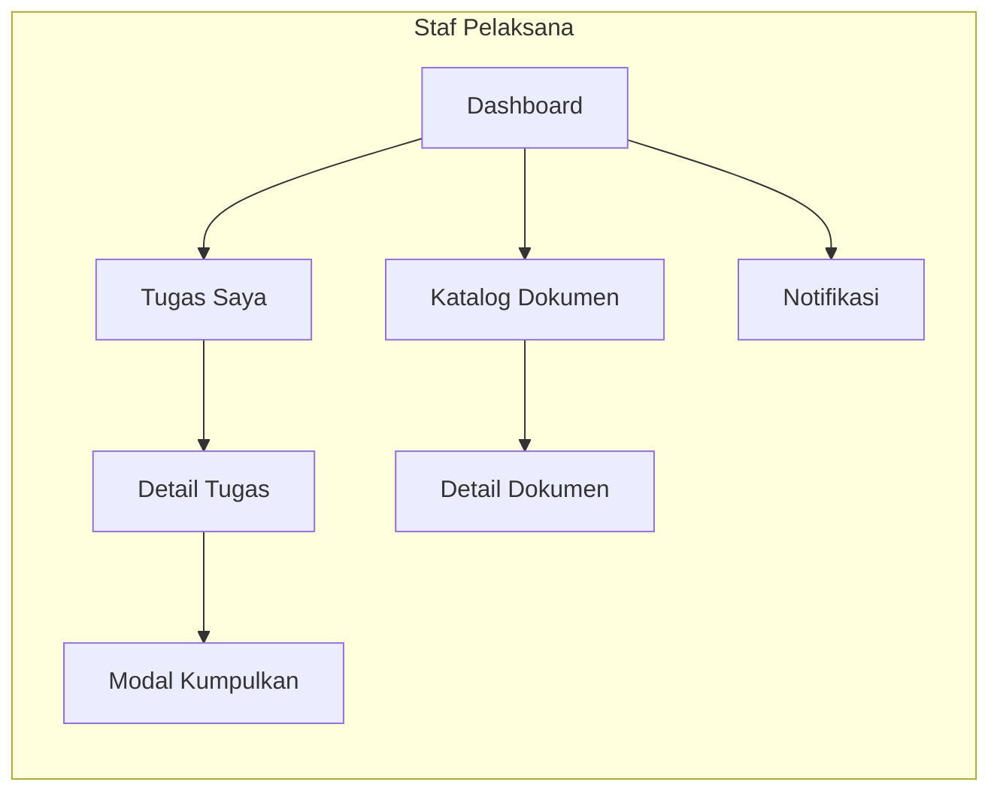
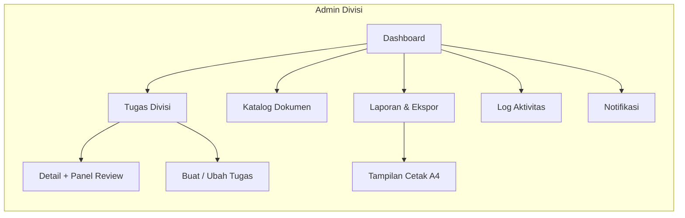
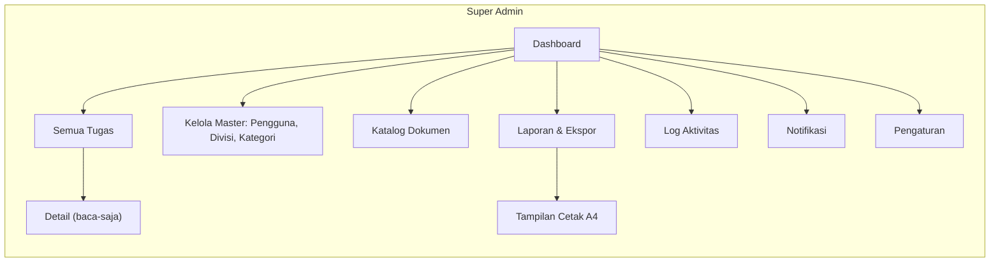
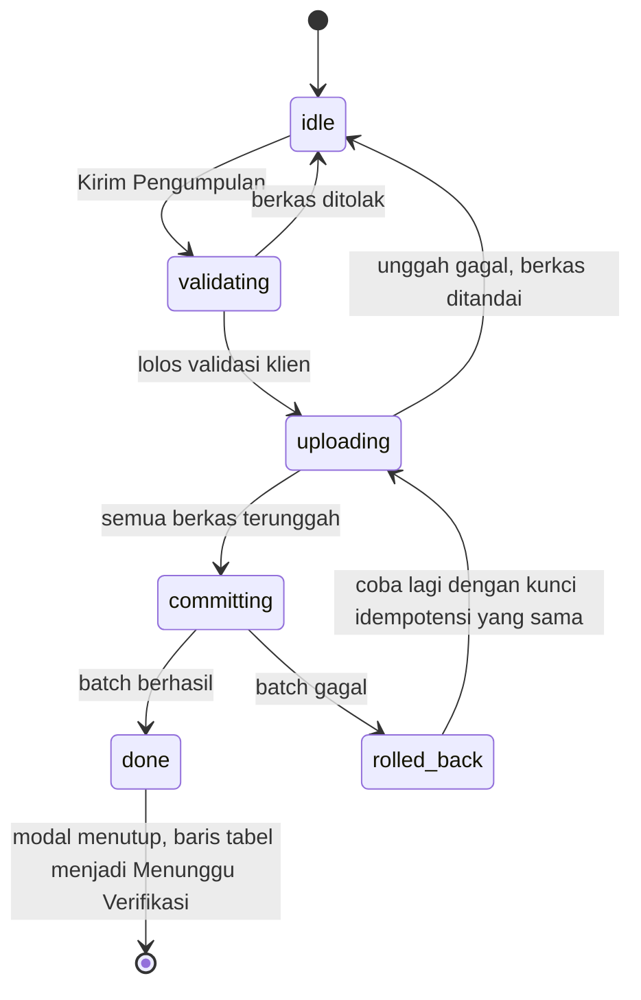

# Wireframe UI/UX: Portal Manajemen Penugasan & Dokumen Divisi

Paket wireframe low-fi untuk 18 layar, tiga peran, plus lembar state dan lembar reflow ponsel. Wireframe ini menggambar **struktur, hierarki, dan keputusan yang diambil pengguna di tiap layar**, bukan tampilan akhir berwarna.

*Reading this as: aplikasi kerja internal instansi untuk staf, admin divisi, dan super admin, dalam bahasa visual grid Swiss institusional, dial ENERGY 1 / RHYTHM 2 / MOTION 1 (`DESIGN.md` §6).*

Aturan gambar: `SPEC-SVG.md`. Arah rasa: `DESIGN.md`. Token dan aturan teknis: `DESIGN-SYSTEM.md`. Aturan bisnis: `RANCANGAN-SISTEM-v2.md`.

## 1. Aturan yang dipegang seluruh paket

| Sumber | Yang mengikat di sini |
|---|---|
| `RANCANGAN-SISTEM-v2.md` §2 | Hak akses per peran; Super Admin baca-saja untuk data tugas |
| §3.1, §3.2 | Hanya 5 status kanonik; transisi di luar tabel ditolak server |
| §3.3 | `Perlu Revisi`, `Terlambat`, `Tenggat Dekat`, `Terarsip` adalah flag turunan, bukan status |
| §7.1 | Setiap angka mencantumkan satuan (`task` atau `assignment`) dan jendelanya |
| §7.3 | Kartu KPI dapat diklik dan membawa filter ke daftar tugas |
| §8.1 sampai §8.5 | 6 state modal pengumpulan, batas berkas, optimistic UI setelah commit, aksesibilitas modal |
| `DESIGN-SYSTEM.md` §9 | 15 aturan pantang dilanggar (warna bukan penanda tunggal, teks minimum 12px, angka tabular, dst) |
| `DESIGN.md` §3, §6 | Motif nomor tugas, satu titik fokus per layar, aksen tunggal |

Data contoh (seed): 5 divisi, 8 kategori, 5 akun. Semua angka pada wireframe adalah **data contoh**, dilabeli di kepala setiap lembar. Nama divisi dan akun: Hukum & Sengketa (HUK), Pengawasan (PGS), SDM & Organisasi (SDM), Sekretariat (SEK), Penindakan (TND); akun `super.admin`, `admin.hukum`, `admin.pengawasan`, `staf.hukum`, `staf.pengawasan`.

## 2. Peta navigasi per peran

Semua peran juga punya **Akun Saya** (profil dan ganti kata sandi). Tidak ada menu tanpa layar: item yang belum dibangun ditandai `(menyusul)` dan digambar redup.

## 3. Daftar 18 layar

| Kode | Layar | Berkas | Aktor | Use case | Fokus layar |
|---|---|---|---|---|---|
| L01 | Login | `L01-login.svg` | semua | UC01 | satu tombol utama, jalur pemulihan tanpa tautan mati |
| L02 | Akun Saya | `L02-akun-saya.svg` | semua | UC01, UC16 | ganti kata sandi sendiri, ubah kontak dan kanal notifikasi |
| L03 | Dashboard Staf | `L03-dashboard-staf.svg` | USER | UC05 | "apa yang perlu saya kerjakan hari ini" |
| L04 | Dashboard Admin Divisi | `L04-dashboard-admin.svg` | ADMIN | UC05 | antrean review dan beban kerja divisi |
| L05 | Dashboard Super Admin | `L05-dashboard-super-admin.svg` | SA | UC05 | kondisi lintas divisi, baca-saja |
| L06 | Tugas Saya | `L06-tugas-saya.svg` | USER | UC08 | temukan tugas yang bisa dikumpulkan sekarang |
| L07 | Detail Tugas (staf) | `L07-detail-tugas-staf.svg` | USER | UC08, UC09 | aksi berikutnya dan riwayat versi |
| L08 | Modal Kumpulkan Tugas | `L08-modal-kumpulkan.svg` | USER | UC09 | 6 state modal dalam satu lembar |
| L09 | Tugas Divisi | `L09-tugas-divisi.svg` | ADMIN | UC08, UC10 | antrean Menunggu Verifikasi |
| L10 | Buat / Ubah Tugas | `L10-form-tugas.svg` | ADMIN | UC06, UC07 | tenggat dan penerima, sekali isi benar |
| L11 | Detail Tugas + Panel Review | `L11-detail-review.svg` | ADMIN | UC10, UC11 | keputusan setuju atau minta revisi |
| L12 | Semua Tugas | `L12-semua-tugas.svg` | SA | UC08 | memantau lintas divisi tanpa bisa mengubah |
| L13 | Katalog Dokumen Final | `L13-katalog-dokumen.svg` | semua | UC11, UC15 | temukan dan unduh dokumen sah |
| L14 | Laporan & Ekspor | `L14-laporan-ekspor.svg` | ADMIN, SA | UC12 | periode, angka periode, ekspor dan cetak |
| L15 | Log Aktivitas | `L15-log-aktivitas.svg` | ADMIN, SA | UC13 | siapa mengubah apa, sebelum dan sesudah |
| L16 | Notifikasi | `L16-notifikasi.svg` | semua | UC14 | apa yang menunggu saya, dan ke mana perginya |
| L17 | Kelola Master | `L17-kelola-master.svg` | SA | UC02, UC03, UC04 | pengguna termasuk NIP, divisi, kategori dalam tiga tab |
| L18 | Pengaturan | `L18-pengaturan.svg`, `L18-pengaturan-sistem.svg` | ADMIN, SA | UC17 | kontak dan nilai awal divisi, kebijakan berkas, ambang tenggat |

Lembar tambahan:

| Berkas | Isi |
|---|---|
| `state-kosong.svg` | pola keadaan kosong (pertama kali, hasil filter nol, tanpa akses) |
| `state-memuat.svg` | pola memuat (skeleton tabel, skeleton kartu KPI, tombol `aria-busy`) |
| `state-galat.svg` | pola galat (galat muat, galat simpan, galat unggah) |
| `state-403.svg` | layar 403 tanpa detail internal |
| `mobile-reflow.svg` | tiga layar ponsel: L06, L08, L03 |

## 4. Isi wajib per layar

### L02 Akun Saya
Tiga kartu. **Profil** (baca-saja penuh): nama lengkap, NIP (`-` bila kosong), jabatan, divisi, peran (chip), nama pengguna, dengan catatan "Data kepegawaian diubah Super Admin". **Kontak & notifikasi**: surel + status `Terverifikasi`/`Belum terverifikasi` + tombol `Ubah Surel`; nomor WhatsApp tersamar (`+62 812•••• 345`) + status + tombol `Ubah Nomor`; dua toggle `Email` dan `WhatsApp` yang **mati secara default** dan tidak dapat dinyalakan sebelum alamatnya terverifikasi. Dialog ubah surel: isian alamat baru + catatan "Tautan verifikasi dikirim ke alamat baru. Alamat lama tetap dipakai sampai tautan dibuka." Dialog ubah nomor: isian nomor + kode 6 angka + catatan "Kode berlaku 10 menit, maksimal 5 percobaan." **Keamanan**: kata sandi lama, kata sandi baru, ulangi kata sandi baru, tombol `Simpan Kata Sandi` (titik fokus), catatan "Sesi lain akan diakhiri setelah kata sandi berubah" dan "Sesi berakhir otomatis setelah 8 jam tanpa aktivitas" (`RANCANGAN` §9.2). Kebijakan panjang sandi: kolom menampilkan "mengikuti kebijakan instansi [KONFIRMASI]", tidak mengarang aturan.

### L03 Dashboard Staf
Pita KPI 6 kartu, semuanya berangka dan bersatuan: `Aktif: 5 penugasan`, `Perlu Revisi: 1`, `Terlambat: 1`, `Total Penugasan: 16`, `Selesai: 12`, `Tepat Waktu: 10 dari 12`. Dua panel: **Aktif per Status** (5 baris status kanonik + hitungan, tiap baris mengarah ke L06 terfilter) dan **Perlu Tindakan** (baris revisi dengan kutipan catatan admin, baris tenggat hari ini). Panel bawah: 3 tugas terdekat tenggatnya. Setiap angka mengikuti §7.2. Titik fokus: baris "Perlu Tindakan".

### L04 Dashboard Admin Divisi
Pita KPI 6: `Anggota: 8`, `Penugasan Aktif: 14`, `Menunggu Verifikasi: 6`, `Perlu Revisi: 3`, `Terlambat: 4`, `Dokumen Final: 92`. Panel **Beban Kerja (aktif / total)** per staf dengan rantai keanggotaan, catatan "Menampilkan 3 dari 8 staf" + tautan `Lihat semua di Tugas Divisi` (L09). Panel **Tenggat & Keterlambatan**: baris Terlambat dan baris tenggat dekat dengan sisa waktu, ambang 3 hari ditulis sebagai catatan. Panel **Antrean Review**: jumlah menunggu, waktu tunggu tertua, tombol `Tinjau Sekarang` (L09). Titik fokus: tombol Tinjau Sekarang.

### L05 Dashboard Super Admin
Baris baca-saja tepat di bawah top bar: "Seluruh divisi. Data tugas hanya dapat dibaca, tidak diubah dari akun ini." Pita KPI 6: `Pengguna: 48`, `Divisi: 5`, `Tugas: 312 task`, `Penugasan: 401 assignment`, `Dokumen Final: 286`, `Antrean Review Lebih dari 2 Hari: 7`. Panel **Progres Penugasan per Divisi**: 5 batang dengan nilai dan pecahan (`85%, 68 dari 80`), catatan "Total 286 dari 378 penugasan, 23 Dibatalkan dikeluarkan dari penyebut". Panel **Distribusi Status**: 5 baris status kanonik + jumlah dan persen, catatan "Total selalu 100%" dan "Tunggu review terlama: 2 hari". Tidak ada tombol aksi data tugas, hanya tautan `Lihat daftar` ke L12.

### L06 Tugas Saya
Baris filter: kotak cari nomor/judul, pemilih status (5 kanonik), kelompok penanda terpisah (`Terlambat`, `Perlu Revisi`, `Terarsip`), rentang tenggat, dan tautan `Hapus filter`. Filter diterapkan saat nilainya berubah, tanpa tombol Terapkan, karena daftar ini dibuka puluhan kali sehari. Tabel: `Judul Tugas` (nomor mono di baris kedua), `Tenggat` (tanggal WIB + sisa waktu), `Prioritas` (Rendah, Sedang, Tinggi, Mendesak), `Status` (pill + maksimal satu flag), `Aksi`. Aksi per status: `BELUM_DIKERJAKAN` menampilkan `Mulai Kerjakan` (transisi Belum Dikerjakan ke Sedang Dikerjakan, §3.2), `SEDANG_DIKERJAKAN` menampilkan `Kumpulkan Tugas` (L08), `MENUNGGU_VERIFIKASI` menampilkan chip redup `Menunggu Verifikasi` + `Lihat Berkas` (L07), `SELESAI` menampilkan `Unduh Bukti Terarsip` (L13), `DIBATALKAN` menampilkan `Lihat Alasan` (L07). Paginasi 25/50/100.

### L07 Detail Tugas (staf)
Kepala: nomor tugas mono, judul, pill status, flag, chip prioritas, tenggat dan sisa waktu, divisi, kategori, pembuat, waktu dibuat. Isi: deskripsi, batas berkas aktif (default 10 MB per berkas dan 5 berkas; dibaca dari `app_settings`), **Riwayat Pengumpulan** berisi kartu per versi: versi, status, waktu kirim, catatan pelaksana, daftar berkas (nama asli, ukuran, mono checksum), dan untuk versi yang ditolak: catatan revisi admin + nama pemeriksa. **Panel aksi** menyesuaikan status: `Mulai Kerjakan` (Belum Dikerjakan), `Kumpulkan Tugas` (Sedang Dikerjakan, termasuk setelah revisi), chip terkunci + `Lihat Berkas` (Menunggu Verifikasi), `Unduh Bukti Terarsip` (Selesai), alasan pembatalan (Dibatalkan).

### L08 Modal Kumpulkan Tugas
Satu lembar berisi 6 panel modal (`RANCANGAN` §8.1) dengan urutan `idle`, `validating`, `uploading`, `committing`, `done`, `rolled_back`. Tiap panel digambar sebagai modal di atas tabel yang diredupkan, dengan nomor state dan satu kalimat penjelas. Isi modal tetap: judul tugas + nomor mono, area catatan (opsional, maksimal 2.000 karakter, penghitung), area seret berkas (tipe dan batas aktif dari `app_settings`; default PDF, DOC, DOCX, XLS, XLSX, JPG, JPEG, PNG, 5 berkas, 10 MB per berkas), daftar berkas dengan progres per berkas, tombol `Kirim Pengumpulan` dan `Batal`. Panel `rolled_back` menampilkan pesan gagal, berkas yang sudah terunggah ditandai, dan tombol coba lagi memakai kunci idempotensi yang sama. Catatan aksesibilitas ditulis pada panel: fokus masuk ke kolom catatan dan terperangkap, `Esc` menutup kecuali saat mengunggah, galat diumumkan `aria-live="polite"`.

Angka batas dan daftar tipe yang tercetak di L07, L08, `state-galat.svg`, dan `mobile-reflow.svg` adalah nilai default. Di aplikasi, teks itu dibangun dari `app_settings` saat dirender, sehingga penurunan batas oleh Super Admin langsung terlihat tanpa mengubah gambar.

### L09 Tugas Divisi
Pita ringkas 4 angka: `Penugasan Aktif: 14`, `Menunggu Verifikasi: 6`, `Terlambat: 4`, `Perlu Revisi: 3`. Baris filter dengan pintasan `Antrean Menunggu Verifikasi` sebagai chip aktif pertama, ditambah pemilih penerima (anggota divisi), kategori, dan rentang tenggat. CTA `Buat Tugas` (L10) sebagai tombol utama. Tabel: `Nomor & Judul`, `Penerima` (avatar inisial + nama, `+3` bila banyak), `Tenggat`, `Status`, `Aksi` (`Tinjau` untuk Menunggu Verifikasi ke L11, `Ubah` untuk tugas belum selesai ke L10, `Batalkan` memakai dialog alasan, `Lihat` untuk tugas selesai dan dibatalkan ke L11).

### L10 Buat / Ubah Tugas
Formulir dua kolom. Kiri: judul, deskripsi, kategori (master), prioritas (Rendah, Sedang, Tinggi, Mendesak), tanggal mulai, tenggat. Kanan: **Penerima** (daftar anggota divisi dengan kotak centang, pencarian, `Pilih semua`, penghitung "3 pegawai dipilih"), pratinjau nomor tugas mono `HUK/2026/10/007` dengan catatan "dibuat otomatis saat disimpan", dan ringkasan: "Tenggat diperlakukan sebagai 23:59:59 WIB". Bawah: `Simpan & Tugaskan` (utama), `Batal`. Setiap kolom punya ruang pesan galat; yang digambar pada layar ini hanya galat tenggat (`Tenggat tidak boleh lebih awal daripada tanggal mulai`) plus penanda `wajib` pada judul dan penerima, sedangkan galat penerima (`Pilih minimal satu penerima`) dan galat simpan digambar pada `state-galat.svg`. Mode ubah memakai layar yang sama dengan judul `Ubah Tugas` dan catatan "Penerima yang dibatalkan tidak dihapus dari riwayat".

### L11 Detail Tugas + Panel Review (admin)
Kepala detail sama dengan L07, ditambah nama pembuat dan menu tindakan tugas: `Perpanjang Tenggat` (dialog alasan, menulis log nilai lama dan baru) dan `Batalkan Tugas` (tombol danger, alasan wajib). Panel **Pengumpulan Terbaru**: catatan pelaksana, daftar berkas dengan tombol unduh, checksum mono, waktu kirim, versi. Panel **Riwayat Versi**: versi sebelumnya, keputusan, pemeriksa, catatan. Panel **Keputusan** (titik fokus): `Setujui & Arsipkan` (utama, catatan opsional, menyebut efek "1 baris masuk katalog dokumen final"), `Minta Revisi` (wajib catatan, tidak bisa dikirim bila kosong, menyebut efek "status kembali ke Sedang Dikerjakan, penghitung revisi bertambah"). Untuk Super Admin, panel keputusan tidak digambar, diganti pita `Akses baca-saja`.

### L12 Semua Tugas (Super Admin)
Pita peran: `Akses baca-saja: Super Admin tidak mengubah data tugas`. Filter lintas divisi: divisi (semua), status, penanda, kategori, penerima, periode. Pita ringkas 4 angka dengan satuan: `Tugas: 312 task`, `Penugasan: 401 assignment`, `Menunggu Verifikasi: 42`, `Terlambat: 31`. Tabel: `Nomor & Judul`, `Divisi`, `Penerima`, `Tenggat`, `Status`, `Aksi` hanya `Lihat` (L11 versi baca-saja). Tidak ada tombol buat, ubah, atau batalkan.

### L13 Katalog Dokumen Final
Filter: kotak cari, divisi (Super Admin: semua divisi; peran lain: chip terkunci dengan teks `(terkunci)`), kategori, penerima, rentang tanggal arsip. Tabel menampilkan kolom penting saja: `Nomor Tugas`, `Judul Dokumen`, `Diarsipkan` (tanggal WIB), `Berkas` (jumlah), `Aksi` (`Unduh`); kolom `Kategori`, `Divisi`, dan `Penerima` dipindah ke panel samping supaya tabel tidak melampaui lebar kartu. Panel samping detail dokumen (titik fokus): metadata, versi submission terakhir yang disetujui, daftar berkas, tombol `Unduh Semua`, dan catatan "Satu tugas punya satu baris arsip, revisi tidak menambah baris baru" (`RANCANGAN` D1), plus tautan `Lihat tugas asal` ke L07 atau L11.

### L14 Laporan & Ekspor
Baris filter: periode (bulan berjalan, tombol pilih rentang), divisi (mengikuti peran), status, kategori, penerima, kelompokkan menurut (divisi, penerima, kategori). Blok **Ringkasan Periode**: 5 angka bersatuan (`Penugasan: 378`, `Selesai: 286`, `Tepat Waktu: 248 dari 286`, `Terlambat: 31`, `Dokumen Final: 286`). Pratinjau tabel dengan 7 baris contoh dan catatan "Angka pratinjau sama dengan jumlah baris saat diekspor". Tombol `Ekspor XLSX` (utama) dan `Cetak / PDF`. State ekspor berjalan: tombol terkunci dengan `aria-busy` dan pesan "Menyiapkan berkas, 378 baris". **Tampilan Cetak A4** digambar sebagai varian di kanan atau bawah: A4 potret, kop laporan `[KOP INSTANSI]`, judul, periode, daftar filter aktif, waktu cetak, tabel bergaris hitam tanpa warna status, blok tanda tangan, nomor halaman.

### L15 Log Aktivitas
Filter: aktor, jenis aksi (mis. `task.created`, `submission.created`, `assignment.reviewed`, `attachment.downloaded`, `settings.updated`, `division.updated`), entitas, periode. Tabel: `Waktu` (WIB), `Aktor` (nama + peran), `Aksi` (mono), `Entitas` (jenis + nomor tugas mono), `Ringkasan Perubahan` (nilai lama menjadi nilai baru, mis. `due_at: 16 Okt menjadi 19 Okt`), `Catatan`. Pita: `Log tidak dapat diubah atau dihapus lewat antarmuka`. Tidak ada tombol hapus.

### L16 Notifikasi
Kepala: `Belum Dibaca: 4` + tombol `Tandai Semua Dibaca`. Kelompok "Baru" dan "Sudah Dibaca". Tiap baris: ikon jenis, judul, satu kalimat, waktu WIB, dan aksi `Buka tugas` yang mengarah ke layar nyata sesuai jenisnya: `TASK_ASSIGNED` dan `REVISION_REQUESTED` ke L07 (staf) atau L09 (admin), `SUBMISSION_RECEIVED` ke L11, `TASK_CANCELLED` ke L07, `DUE_SOON` ke L06 atau L09. Untuk notifikasi milik sendiri, baris menampilkan status kanal luar bila pengiriman dicoba: `Email terkirim`, `WhatsApp terkirim`, atau `WhatsApp gagal` dengan alasan singkat. Status itu berarti diterima penyedia, bukan dibaca penerima.

### L17 Kelola Master
Tiga tab: **Pengguna** (aktif), **Divisi**, **Kategori**. Tab Pengguna: kotak cari, filter peran dan status, tombol `Tambah Pengguna`, tabel `Nama`, `NIP`, `Nama Pengguna`, `Divisi`, `Peran`, `Status` (Aktif, Nonaktif), `Terakhir Masuk`, `Aksi` (`Ubah`, `Reset Kata Sandi` dengan dialog konfirmasi yang menyebut "sesi pengguna akan diakhiri", `Nonaktifkan` dengan dialog alasan). Form tambah/ubah: nama lengkap, nama pengguna, email, NIP (opsional, 18 digit, unik), jabatan, divisi, peran. NIP kosong ditampilkan `-`, bukan string kosong. Catatan: "Akun beriwayat dinonaktifkan, bukan dihapus" (`RANCANGAN` §11). Tab Divisi: tabel `Nama`, `Kode`, `Anggota`, `Status`, aksi `Ubah` dan `Nonaktifkan`. Tab Kategori: tabel `Nama`, `Jumlah Tugas`, `Status`, aksi `Ubah` dan `Nonaktifkan`, dengan catatan "Kategori nonaktif tidak bisa dipakai tugas baru, riwayat lama tetap tampil".

### L18 Pengaturan
Dua tab. **Divisi** (Admin Divisi dan Super Admin): identitas divisi baca-saja (nama, kode, kepala) dengan catatan bahwa identitas diubah di Kelola Master, kontak divisi yang dapat diubah (dipakai sebagai `Reply-To` email notifikasi divisi), kategori default, dan prioritas default. Pada tab Divisi, chip `Hanya divisi ini` di kanan atas kartu menjadi pemilih divisi untuk Super Admin; Admin melihat chip terkunci itu. Posisi dan tinggi baris tidak berubah. **Sistem** (hanya Super Admin): ukuran maksimum per berkas (1 sampai 10 MB, hanya boleh menurunkan), jumlah berkas per pengumpulan (1 sampai 5), chip tipe berkas (subset dari 8 tipe kanonik, minimal satu), dan ambang tenggat dekat (1 sampai 30 hari). Aksi `Simpan Pengaturan` dan `Batal`. Chip tipe yang tersisa satu tidak dapat dimatikan, dan server tetap menolak subset kosong. Catatan: nilai di luar batas ditolak server, perubahan tidak berlaku surut, dan tab Sistem tidak tampil untuk Admin.

## 5. Keadaan wajib per layar data

Setiap layar data wajib punya empat keadaan berikut; salinan teksnya dipakai apa adanya (antislop R-27, `DESIGN-SYSTEM.md` §7).

| Layar | Kosong | Memuat | Galat | Tanpa akses |
|---|---|---|---|---|
| L06 | "Belum ada tugas untukmu. Tugas yang ditugaskan admin akan muncul di sini." + aksi `Muat ulang` | 6 baris skeleton tabel | "Daftar tugas gagal dimuat. Periksa sambungan lalu muat ulang." + tombol `Coba lagi` | 403: tugas bukan milikmu |
| L09 | "Belum ada tugas di divisi ini. Buat tugas pertama lewat tombol Buat Tugas." + aksi `Buat Tugas` | skeleton tabel + skeleton pita angka | "Daftar tugas divisi gagal dimuat." + `Coba lagi` | 403: tugas di luar divisimu |
| L12 | "Belum ada tugas pada filter ini. Hapus filter untuk melihat semuanya." + aksi `Hapus filter` | skeleton tabel | "Data lintas divisi gagal dimuat." + `Coba lagi` | 403: bukan Super Admin |
| L13 | "Belum ada dokumen final pada filter ini. Dokumen muncul setelah tugas disetujui." | skeleton baris | "Katalog gagal dimuat." + `Coba lagi` | 403: dokumen di luar scopa divisimu |
| L14 | "Periode ini tidak punya penugasan. Pilih periode lain." | kerangka ringkasan + tabel | "Laporan gagal dihitung." + `Coba lagi` | 403: laporan hanya untuk admin dan super admin |
| L15 | "Belum ada aktivitas pada filter ini." | skeleton baris | "Log gagal dimuat." + `Coba lagi` | 403: log hanya untuk admin dan super admin |
| L16 | "Belum ada notifikasi. Pemberitahuan tugas dan review muncul di sini." | skeleton 3 baris | "Notifikasi gagal dimuat." + `Coba lagi` | 403: bukan pemilik notifikasi |

Aturan keadaan kosong: sebutkan sebab dan aksi berikutnya, tidak menulis "Tidak ada data" saja. Tiga sebab dibedakan: pertama kali (belum ada data), hasil filter nol, dan tanpa akses.

## 6. Alur modal pengumpulan (ringkas)

Dua aturan yang harus terlihat di gambar: (1) baris tabel berubah **setelah** commit berhasil, bukan saat tombol ditekan; (2) tombol kirim terkunci sejak ditekan pertama sehingga klik ganda tidak membuat dua pengumpulan.

## 7. Peta rujukan layar ke aturan

| Layar | Rujukan utama |
|---|---|
| L01, L02 | `RANCANGAN` §9.2 (kredensial, sesi 8 jam, reset oleh Super Admin) |
| L03, L04, L05 | `RANCANGAN` §7.1 dan §7.2 (`DESIGN-SYSTEM` §7 komponen kartu KPI) |
| L06, L07, L09, L11, L12 | `RANCANGAN` §3.1, §3.2, §3.3 (status, transisi, flag) |
| L08 | `RANCANGAN` §8.1 sampai §8.5 |
| L10 | `RANCANGAN` §5A, §12 #4 dan #6 (nomor tugas, tenggat 23:59:59 WIB) |
| L13 | `RANCANGAN` D1, §11 (satu baris per assignment) |
| L14 | `DESIGN-SYSTEM` §8 (aturan cetak), `RANCANGAN` §12 #12 |
| L15, L17 | `RANCANGAN` §9.2, §11, D9 (nonaktifkan, bukan hapus) |
| L16 | `RANCANGAN` §6.3 (jenis notifikasi) |

## 8. Status berkas

Seluruh berkas selesai: 18 layar (`L01` sampai `L18`; L18 memakai dua berkas karena isi tiap tab panjang), 5 lembar tambahan (`state-kosong`, `state-memuat`, `state-galat`, `state-403`, `mobile-reflow`), plus `SPEC-SVG.md` dan dokumen ini. Total 24 berkas SVG.

## 9. Laporan Delivery Gate

Mode: DURING. Diperiksa setelah seluruh berkas selesai. Setiap `LULUS` disertai bukti.

**Blok 1: Hard Gate (semua jawaban harus tidak)**

| Aturan | Hasil | Bukti |
|---|---|---|
| R-02 em dash | LULUS | Hitungan tanda pisah panjang pada 24 berkas SVG = 0 |
| R-03 luber ponsel | LULUS | Tidak ada teks di luar kanvas; lembar `mobile-reflow.svg` punya 3 bingkai 390x780, target sentuh 44 px, tanpa gulir mendatar |
| R-17, R-18 angka dan testimoni | LULUS | Semua angka berasal dari `RANCANGAN-SISTEM-v2.md` §7.2 atau seed; kepala setiap lembar berbunyi `data contoh (seed), bukan data nyata`; tidak ada testimoni |
| R-23 aset | LULUS | Logo `[LOGO]`, instansi `[NAMA INSTANSI]`, kop `[KOP INSTANSI]`, avatar inisial dua huruf, tanpa foto orang |
| R-24 navigasi | LULUS | Pemeriksaan rujukan: kode `L01` sampai `L18` yang dipakai sebagai tujuan semuanya punya berkas; tidak ada tautan ke layar yang tidak ada; item `(menyusul)` hanya diatur di `SPEC-SVG.md`, tidak digambar sebagai tautan |
| R-25 kontras | LULUS | 19 pasangan warna dipakai di wireframe, semuanya diperiksa dengan `.claude/skills/antislop-human/contrast-check.py`, terendah 4,51:1 (`status-menunggu`) |
| R-26 kontrol berfungsi | LULUS | Setiap tombol dan tautan punya tujuan nyata atau state yang digambar (dialog, modal, panel). `L01` tidak memuat tautan "lupa kata sandi" karena layarnya tidak ada, diganti kalimat kontak |
| R-27 keadaan | LULUS | `state-kosong.svg`, `state-memuat.svg`, `state-galat.svg`, `state-403.svg`, plus tabel salinan teks per layar di §5 |
| R-32 papan ketik | LULUS | Catatan fokus dan `Esc` pada `L08`; setiap kontrol digambar sebagai kontrol nyata, bukan teks mati |
| R-33 tambalan skrip | LULUS | Semua berkas ditulis langsung, tidak ada skrip penambal |
| R-34 tema | LULUS | Satu tema terang, keputusan dan alasannya di `DESIGN.md` §9 |
| R-35 verifikasi | LULUS | 24 berkas dirender di Chromium; pemeriksaan geometri: 0 teks di luar kanvas, 0 teks melampaui bidangnya; 12 teks di `L17` tertutup dialog, disengaja karena dialog memang menutupi tabel. Pemeriksaan chip otomatis: 58 chip status/flag diperiksa, semuanya berikon 12px di `X+8` dengan label di `X+24`, 0 tumpang tindih, 0 chip melewati `x=1096` |
| R-36, R-38 klaim dan konten | LULUS | Tidak ada klaim keamanan atau kinerja; nama pegawai hanya yang sudah ada di dokumen rancangan atau seed |
| R-37 arah | LULUS | `DESIGN.md` ada, dial ENERGY 1 / RHYTHM 2 / MOTION 1 dinyatakan |

**Blok 2: Purpose-Gate (teknik tanpa alasan = gagal)**

| Aturan | Hasil | Alasan tertulis |
|---|---|---|
| R-01 gradien | LULUS | Tidak ada gradien di seluruh wireframe |
| R-04 ikon | LULUS | Navigasi dan lonceng memakai nama serta makna glif set tunggal `DESIGN-SYSTEM.md` §7.1 (`src/app/icons.tsx`), bukan set pustaka pihak ketiga; tidak ada bintang, kilau, atau ikon hias. Wireframe menggambar ulang bentuk pada grid 16 sebagai sketsa, bukan menyalin path final. 1 chip peran (`Staf` di `L02`) sengaja tanpa ikon karena bukan status |
| R-06 tipografi | LULUS | Inter untuk tabel padat, JetBrains Mono untuk nomor tugas (`DESIGN.md` §5) |
| R-07 latar bermotif | LULUS | Tidak ada pola latar |
| R-08 panah tombol | LULUS | Tidak ada panah hias |
| R-09 lencana | LULUS | Lencana notifikasi memuat angka nyata; chip peran memuat peran nyata |
| R-10, R-12, R-13 glass, bayangan, glow | LULUS | Tidak dipakai sama sekali |
| R-14 kartu seragam | LULUS | Kartu berbeda menurut isinya: pita KPI, panel grafik, panel beban kerja, kartu dialog |
| R-19 animasi | LULUS | Sesuai MOTION 1, hanya state; tidak ada animasi digambar |
| R-22 ilustrasi | LULUS | Kotak netral pada keadaan kosong, tanpa ilustrasi stok |

**Blok 3: Liveliness (semua jawaban harus ya)**

| Pertanyaan | Hasil | Bukti |
|---|---|---|
| Dial dinyatakan | LULUS | ENERGY 1 / RHYTHM 2 / MOTION 1 di `DESIGN.md` §6 |
| Konsisten dengan dial | LULUS | Tidak ada animasi; pecahan ritme terlihat pada perbedaan pita KPI, panel grafik, dan tabel |
| Satu titik fokus per layar | LULUS | `L03` baris Perlu Tindakan, `L05` panel progres, `L09` tombol Tinjau, `L11` panel Keputusan, `L13` panel detail |
| Ruang kosong struktural | LULUS | Jarak 16 px antar kartu, 24 px padding, sisa ruang dipakai untuk catatan yang menjawab pertanyaan pengguna |
| Satu aksen | LULUS | Merah `#B7091E` hanya pada tombol utama, pill menu aktif, dan seri utama grafik |
| Motif identitas | LULUS | Nomor tugas mono muncul di baris tabel, kepala detail, katalog, dan log |
| Design Read dinyatakan | LULUS | Dinyatakan sebelum berkas pertama ditulis |

**Blok 4: Quality Locks (semua jawaban harus tidak)**

| Aturan | Hasil | Bukti |
|---|---|---|
| R-05 pola template | LULUS | Tidak ada hero, tiga kartu fitur, atau galeri logo; urutan bagian mengikuti pertanyaan pengguna |
| R-11 radius seragam | LULUS | 6 px chip, 8 px tombol, 10 px kartu, 16 px dialog |
| R-15 CTA umum | LULUS | Label berupa tindakan kerja: `Kumpulkan Tugas`, `Tinjau`, `Setujui & Arsipkan`, `Simpan & Tugaskan` |
| R-16 kata klise | LULUS | Tidak ada kata klise pemasaran pada 24 berkas |
| R-20 keumuman | LULUS | Tanpa nama instansi dan logo, struktur tetap dikenali dari nomor tugas mono dan grid padat |
| R-21 tema | LULUS | Tidak ada toggle gelap yang dijanjikan; alasan tema tunggal tertulis |
| R-29 palet | LULUS | Pemeriksaan otomatis: semua nilai warna berada di dalam palet `SPEC-SVG.md` §2 |
| R-30 tiru produk lain | LULUS | Tidak ada tiruan produk tertentu; bentuk mengikuti grid Swiss dan isi tabel |
| R-31 alasan satu baris | LULUS | Tertulis di `DESIGN.md` §3 sampai §6 dan di `SPEC-SVG.md` §8 |

Cacat yang ditemukan dan dibetulkan saat verifikasi: 3 pesan teks melampaui kanvas (2 lembar keadaan, 1 lembar ponsel), 2 teks melampaui bidang kartunya (lembar keadaan), 1 catatan melampaui bingkai ponsel, 1 chip divisi bertumpuk dengan catatan `terkunci`, dan 1 salah ketik pada panel `done`. Semuanya dibetulkan, lalu pemeriksaan diulang sampai bersih.
